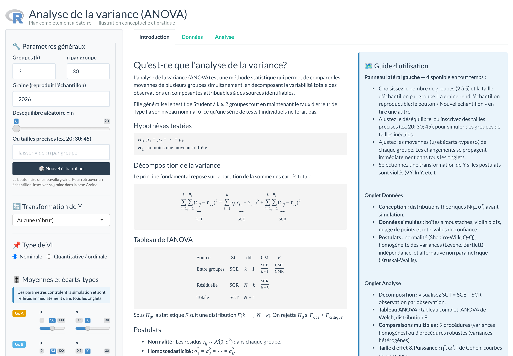

# Quand comparer des moyennes? {#sec-reperes}

```{r}
#| include: false
source("_common.R")
# Régression sur indicatrices du cas fil rouge (référence : Groupe A)
reg <- lm(y ~ groupe, data = fil)
b <- coef(reg)
r2 <- summary(reg)$r.squared
```

::: {.callout-note appearance="simple"}
## Dans ce chapitre

- reconnaître une question qui relève d'une ANOVA à un facteur;
- écrire le modèle $Y_{ij}=\mu+\tau_i+\varepsilon_{ij}$ et traduire $H_0$ dans ses termes;
- comprendre pourquoi un test global précède les comparaisons deux à deux;
- situer l'ANOVA dans le modèle linéaire (régression sur indicatrices);
- distinguer ce que le test établit de ce que seul le plan peut établir.
:::

> **Idée centrale.** L'ANOVA ne compare pas directement des moyennes : elle compare deux façons d'estimer la variance. Si les groupes ne diffèrent pas, l'écart entre leurs moyennes ne devrait pas être plus grand que ce que la dispersion à l'intérieur des groupes laisse prévoir.

## La question statistique

Une ANOVA à un facteur sert à étudier l'association entre une variable indépendante qualitative, qui définit $k$ groupes, et une variable dépendante quantitative. La question générale est : **la moyenne de Y est-elle la même dans toutes les populations représentées par les groupes?**

Exemples : le niveau moyen d'anxiété diffère-t-il entre trois modalités d'intervention? Le score moyen de réussite diffère-t-il entre quatre méthodes pédagogiques? Le revenu moyen diffère-t-il entre catégories de formation?

Trois conditions définissent le cadre de ce manuel :

- **un seul facteur** (une variable qui forme les groupes), avec $k \geq 2$ niveaux;
- **des groupes indépendants** : chaque personne appartient à un seul groupe et fournit une seule mesure;
- **une variable dépendante quantitative**, dont la moyenne a un sens.

Si l'une de ces conditions manque (mesures répétées, deux facteurs croisés, variable dépendante binaire), un autre modèle convient mieux. L'esprit de l'analyse reste toutefois le même.

## Le modèle

Le modèle s'écrit

$$Y_{ij}=\mu+\tau_i+\varepsilon_{ij},\qquad \varepsilon_{ij}\sim\mathcal N(0,\sigma^2),$$ {#eq-modele}

où $Y_{ij}$ est le score de la personne $j$ du groupe $i$, $\mu$ est la moyenne générale, $\tau_i=\mu_i-\mu$ l'écart propre au groupe $i$ (son **effet**) et $\varepsilon_{ij}$ la part non expliquée par l'appartenance au groupe. Les effets sont définis de façon à s'annuler en moyenne : $\sum_i n_i\tau_i=0$.

Chaque terme a une lecture concrète. La moyenne $\mu_i=\mu+\tau_i$ est ce que l'on prédirait pour une personne du groupe $i$. Le terme d'erreur rassemble tout le reste : différences individuelles, conditions de mesure, imprécision de l'instrument. Le modèle suppose que ces erreurs sont indépendantes, centrées, de même variance $\sigma^2$ dans tous les groupes et, pour l'inférence exacte, normales. Ces postulats sont examinés au chapitre [-@sec-postulats].

Dans ces termes, l'hypothèse nulle a deux écritures équivalentes :

$$H_0:\ \mu_1=\mu_2=\cdots=\mu_k \quad\Longleftrightarrow\quad H_0:\ \tau_1=\tau_2=\cdots=\tau_k=0.$$

L'hypothèse alternative est qu'**au moins une** moyenne diffère des autres. Elle ne précise ni laquelle ni dans quel sens.

## Cas fil rouge : soutien à la réussite

Tout au long du manuel, nous suivrons une étude fictive. Une faculté assigne aléatoirement des étudiantes et étudiants à l'un de trois dispositifs de soutien, puis mesure un score de réussite sur 100 à la fin de la session.

| Groupe dans l'application | Dispositif | Paramètres de départ |
|:--|:--|:--|
| Groupe A | Ressources en ligne | $\mu=50$, $\sigma=10$, $n=30$ |
| Groupe B | Tutorat hebdomadaire | $\mu=54$, $\sigma=10$, $n=30$ |
| Groupe C | Tutorat + rétroaction personnalisée | $\mu=60$, $\sigma=10$, $n=30$ |

: Paramètres de population du cas fil rouge. {#tbl-fil}

L'assignation aléatoire rend ici l'interprétation causale défendable, à condition que le protocole ait été correctement suivi. Ces paramètres ne sont pas des résultats : ils décrivent le scénario de simulation, c'est-à-dire la « vérité » que l'on ignorerait dans une étude réelle. Avec la graine 2026, l'application en produit une réalisation précise, dont les moyennes observées sont `r fr(fil_a$m[1])`, `r fr(fil_a$m[2])` et `r fr(fil_a$m[3])`. L'écart entre ces valeurs et 50, 54 et 60 est l'aléa d'échantillonnage que l'inférence doit prendre en compte.

::: {.case}
Dans ce scénario, les effets de population valent $\tau_A=50-54{,}67=-4{,}67$, $\tau_B=-0{,}67$ et $\tau_C=+5{,}33$ (la moyenne générale est $\mu=54{,}67$). $H_0$ est donc fausse par construction. La question devient : un échantillon de 90 personnes suffit-il à le montrer?
:::

## Une ANOVA plutôt que plusieurs tests t

Avec trois groupes, on peut former trois comparaisons deux à deux; avec cinq groupes, dix. Effectuer tous les tests $t$ au seuil de 0,05 augmente la probabilité de déclarer au moins une différence par hasard. Cette probabilité porte un nom : le **taux d'erreur par famille** (*familywise error rate*, FWER).

```{r}
#| label: fig-inflation
#| fig-cap: "Probabilité de déclarer au moins une différence alors que toutes les moyennes sont égales, si l'on effectue tous les tests t deux à deux au seuil de 0,05 (n = 30 par groupe). Barres : 4 000 simulations par valeur de k. Losanges : borne 1 − 0,95^m, valable pour m tests indépendants. Tirets : le seuil nominal de 5 %."
#| fig-height: 3.6
set.seed(1)
inf <- do.call(rbind, lapply(2:5, function(k) {
  n <- 30; R <- 4000
  hit <- replicate(R, {
    y <- matrix(rnorm(n * k), n); m <- colMeans(y); v <- apply(y, 2, var)
    pr <- combn(k, 2)
    any(apply(pr, 2, function(p) abs(m[p[1]] - m[p[2]]) / sqrt((v[p[1]] + v[p[2]]) / n) > qt(.975, 2 * n - 2)))
  })
  data.frame(k = k, m = choose(k, 2), sim = mean(hit), borne = 1 - 0.95^choose(k, 2))
}))
ggplot(inf, aes(factor(k))) +
  geom_col(aes(y = sim), fill = pal$bleu, width = 0.6) +
  geom_point(aes(y = borne), shape = 23, size = 3, fill = pal$or) +
  geom_hline(yintercept = 0.05, linetype = 2, colour = pal$rouge) +
  geom_text(aes(y = sim, label = pc(sim, 0)), vjust = -0.5, size = 3.6) +
  scale_x_discrete(labels = function(k) paste0("k = ", k, "\n(", choose(as.numeric(k), 2), ifelse(k == "2", " test)", " tests)"))) +
  scale_y_continuous(labels = function(x) paste0(axe_fr(100 * x), " %"), limits = c(0, 0.45)) +
  labs(x = NULL, y = "Au moins un faux positif")
```

La @fig-inflation montre l'ampleur du problème. Avec cinq groupes, une chercheuse qui ferait les dix tests $t$ conclurait à tort à au moins une différence dans environ `r pc(inf$sim[4], 0)` des études où il n'y en a aucune, soit plus de cinq fois le risque annoncé. La borne $1-0{,}95^m$ exagère un peu le problème, parce que les tests partagent des groupes et ne sont donc pas indépendants, mais l'inflation est bien réelle.

L'ANOVA fournit d'abord un **test global unique** de $H_0$, dont le risque d'erreur de première espèce est exactement $\alpha$ lorsque les postulats tiennent. Elle ne dit pas encore quelles moyennes diffèrent; ce sera le rôle des comparaisons du chapitre [-@sec-comparaisons], qui contrôlent elles aussi le taux d'erreur par famille.

## L'ANOVA est une régression

Un facteur à $k$ niveaux peut être codé par $k-1$ **variables indicatrices**. Avec le Groupe A comme référence :

| Groupe | $X_B$ | $X_C$ | Moyenne prédite |
|:--|:-:|:-:|:--|
| Groupe A | 0 | 0 | $b_0$ |
| Groupe B | 1 | 0 | $b_0+b_B$ |
| Groupe C | 0 | 1 | $b_0+b_C$ |

: Codage par indicatrices d'un facteur à trois niveaux. {#tbl-indicatrices}

La régression $\hat Y=b_0+b_BX_B+b_CX_C$ reproduit exactement les trois moyennes de groupe. L'ordonnée à l'origine est la moyenne du groupe de référence et chaque coefficient est un écart à cette référence. Pour le cas fil rouge :

$$\hat Y = `r frm(b[1])` + `r frm(b[2])`\,X_B + `r frm(b[3])`\,X_C .$$

On retrouve $\bar Y_A=`r frm(b[1])`$, $\bar Y_B=`r frm(b[1])`+`r frm(b[2])`=`r frm(fil_a$m[2])`$ et $\bar Y_C=`r frm(fil_a$m[3])`$. Le $R^2$ de cette régression vaut `r fr(r2, 3)`, exactement le $\eta^2$ de l'ANOVA (chapitre [-@sec-effet]), et son test $F$ global est identique à celui du tableau ANOVA, $F(2, 87)=`r frm(fil_a$F)`$.

L'ANOVA est donc un cas particulier du **modèle linéaire général**. Ce lien explique pourquoi les mêmes postulats reviennent en régression et pourquoi les contrastes du chapitre [-@sec-contrastes] ne sont rien d'autre que des façons particulières de coder le facteur.

::: {.callout-note}
## Variable indépendante quantitative ou ordinale

Si les niveaux sont des doses, des durées ou des intensités, l'ANOVA les traite tout de même comme des catégories : elle ignore leur ordre. Dans l'application, l'option **Type de VI ▸ Quantitative / ordinale** renomme les groupes « Niveau 1, Niveau 2... » et rappelle ce point dans l'onglet **Conception**. Pour tirer parti de l'ordre, on utilise l'analyse de tendance (section [-@sec-tendance]).
:::

## Ce que l'ANOVA ne démontre pas

Un résultat significatif ne prouve pas que le facteur a causé les différences. L'interprétation causale dépend du plan : assignation aléatoire, groupe contrôle, temporalité et contrôle des variables concurrentes. Avec des groupes naturels (p. ex. niveaux de scolarité), l'ANOVA décrit une différence moyenne conditionnelle aux groupes observés; elle ne supprime pas les facteurs de confusion.

À l'inverse, un résultat non significatif ne prouve pas l'égalité des moyennes. Il indique que les données ne permettent pas de rejeter $H_0$, ce qui peut tenir à un effet nul, à un effet petit ou à un échantillon trop petit pour le détecter (chapitre [-@sec-effet]).

## Dans l'application

{#fig-cap-interface .capture}

Le panneau latéral (@fig-cap-interface) contient tout ce qui définit le scénario :

- **Groupes (k)** et **n par groupe** : le nombre de groupes (2 à 5) et la taille commune;
- **Graine (reproduit l'échantillon)** : le point de départ du générateur aléatoire; la même graine redonne exactement les mêmes données;
- **Déséquilibre aléatoire ± n** et **Ou tailles précises** : deux façons d'obtenir des groupes de tailles inégales;
- **🎲 Nouvel échantillon** : tire une nouvelle graine, donc un autre échantillon du même scénario;
- **Transformation de Y**, **Type de VI**, puis les curseurs $\mu$ et $\sigma$ de chaque groupe.

::: {.app-step}
Au démarrage, l'application affiche le cas fil rouge : 3 groupes de 30, moyennes 50, 54 et 60, écarts-types de 10, graine 2026. Lisez l'onglet **Introduction**, puis passez à **Données ▸ Conception**. Avant toute manipulation, formulez une prédiction : si l'on éloigne la moyenne du Groupe C des deux autres, quelle source de variabilité devrait augmenter?
:::

::: {.app-step}
Si vous avez modifié les réglages, rechargez la page pour revenir au cas fil rouge, ou remettez les valeurs du @tbl-fil et inscrivez 2026 dans **Graine**. Évitez le bouton **🎲 Nouvel échantillon** tant que vous voulez reproduire les nombres du manuel : il remplace la graine.
:::

## Laboratoire

::: {.app-step}
Réglez les trois moyennes à 50 (écarts-types à 10, graine 2026), puis ouvrez **Analyse ▸ Tableau ANOVA**. Notez $F$ et $p$. Remontez ensuite la moyenne du Groupe C à 60 sans toucher à la graine. Qu'est-ce qui a changé dans les données, et qu'est-ce qui est resté identique?
:::

::: {.callout-tip collapse="true"}
## Réponse

Avec trois moyennes égales, l'application affiche $F(2, 87)=`r frm(nul_a$F)`$, $`r pvm(nul_a$p)`$ : un $F$ proche de (et ici inférieur à) 1, comme on l'attend sous $H_0$. Avec la moyenne du Groupe C à 60, la graine fixe garantit que les **écarts individuels** $\varepsilon_{ij}$ sont les mêmes : chaque observation du Groupe C est simplement décalée de 10 points. La dispersion à l'intérieur des groupes ne bouge pas; seule la distance entre les moyennes augmente, et $F$ grimpe à `r fr(lab1_a$F)`. C'est le principe de toute la suite : changer un seul paramètre à la fois, avec la même graine.
:::

## À retenir

- L'ANOVA à un facteur compare $k$ moyennes de groupes indépendants à l'aide d'un **test global unique**.
- Le modèle $Y_{ij}=\mu+\tau_i+\varepsilon_{ij}$ décompose chaque score en une moyenne générale, un effet de groupe et une erreur; $H_0$ affirme que tous les $\tau_i$ sont nuls.
- Multiplier les tests $t$ gonfle le risque de faux positif; c'est la raison d'être du test global et des procédures de comparaisons corrigées.
- L'ANOVA est une régression sur $k-1$ indicatrices : même $F$, $R^2=\eta^2$.
- Le test établit une différence de moyennes; seul le plan permet de l'interpréter comme un effet causal.

## Quiz

1. Une chercheuse mesure la tension artérielle des mêmes personnes à trois moments. Une ANOVA à un facteur pour groupes indépendants convient-elle?
2. Dans le modèle, que représente $\tau_i$? Que vaut-il pour chaque groupe sous $H_0$?
3. Avec $k=4$ groupes, combien de comparaisons deux à deux peut-on former?
4. Un $F$ significatif dit-il quels groupes diffèrent?
5. Dans une régression sur indicatrices avec le Groupe A comme référence, que représente le coefficient de $X_C$?

::: {.callout-tip collapse="true"}
## Réponses du quiz

1. Non. Les mesures sont répétées sur les mêmes personnes; les observations ne sont pas indépendantes. Il faut une ANOVA à mesures répétées ou un modèle mixte.
2. L'écart entre la moyenne du groupe $i$ et la moyenne générale. Sous $H_0$, tous les $\tau_i$ valent 0.
3. $\binom{4}{2}=6$ comparaisons.
4. Non. Il indique qu'au moins une moyenne diffère; les comparaisons du chapitre [-@sec-comparaisons] identifient lesquelles.
5. La différence $\bar Y_C-\bar Y_A$ entre la moyenne du Groupe C et celle du groupe de référence.
:::
