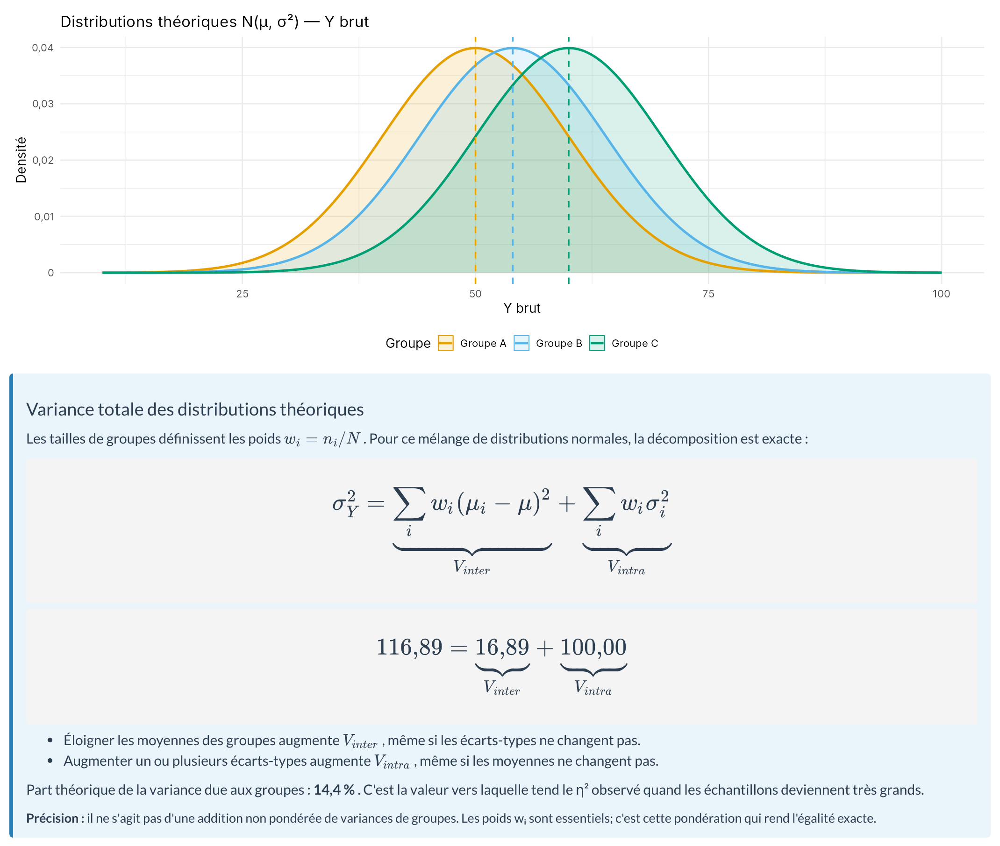

# Concevoir la comparaison avant de générer les données {#sec-concevoir}

```{r}
#| include: false
source("_common.R")
# Décomposition théorique d'un mélange de normales (poids w = n/N)
decomp <- function(mu, sd, ns = rep(30, length(mu))) {
  w <- ns / sum(ns); m <- sum(w * mu)
  c(inter = sum(w * (mu - m)^2), intra = sum(w * sd^2))
}
d_fil <- decomp(c(50, 54, 60), rep(10, 3))
d_bruit <- decomp(c(50, 54, 60), rep(20, 3))
# Puissance du test F pour des tailles inégales (N = 90)
puiss_ns <- function(ns, mu = c(50, 54, 60), s = 10, a = .05) {
  N <- sum(ns); k <- length(ns); mw <- sum(ns * mu) / N
  lam <- sum(ns * (mu - mw)^2) / s^2
  c(lambda = lam, puissance = pf(qf(1 - a, k - 1, N - k), k - 1, N - k, ncp = lam, lower.tail = FALSE))
}
alloc <- list(c(30, 30, 30), c(15, 30, 45), c(45, 30, 15), c(10, 40, 40), c(40, 40, 10))
tab_alloc <- do.call(rbind, lapply(alloc, puiss_ns))
```

::: {.callout-note appearance="simple"}
## Dans ce chapitre

- préciser les éléments d'un plan complètement aléatoire avant toute collecte;
- distinguer ce que règlent les moyennes ($\mu_i$) et ce que règlent les écarts-types ($\sigma_i$);
- décomposer la variance d'une population formée de plusieurs groupes;
- comprendre pourquoi des groupes égaux sont, en général, le meilleur choix.
:::

> **Idée centrale.** Avant même d'avoir des données, la question « les moyennes diffèrent-elles? » se ramène à une comparaison de deux variances : celle qui sépare les centres des groupes et celle qui règne à l'intérieur de chacun. Le plan d'étude fixe déjà les conditions de cette comparaison.

## Le plan complètement aléatoire

Dans le plan visé ici, chaque personne appartient à un seul groupe et contribue une seule mesure à Y. Les groupes sont indépendants. Idéalement, l'assignation aux conditions est aléatoire; dans une étude observationnelle, les groupes existent avant la recherche, ce qui modifie la portée causale de la conclusion, mais non le calcul de l'ANOVA.

Avant de mesurer, il faut préciser :

- la **population** ciblée et la façon d'y recruter;
- la **variable dépendante**, son instrument et son unité;
- les **niveaux du facteur** et ce qui les distingue concrètement;
- la **règle d'assignation** (tirage au sort, blocs, groupes naturels);
- la **taille prévue** de chaque groupe (chapitre [-@sec-effet]);
- les **comparaisons d'intérêt** : toutes les paires, ou quelques hypothèses précises (chapitres [-@sec-comparaisons] et [-@sec-contrastes]).

Ces choix ne devraient pas être reconstruits après avoir vu les résultats. Une hypothèse formulée après coup n'a pas le même statut qu'une hypothèse annoncée.

## Moyennes, écarts-types et distributions

Dans l'application, chaque groupe est représenté par une distribution normale définie par sa moyenne $\mu_i$ et son écart-type $\sigma_i$. Les moyennes déplacent le centre des courbes; les écarts-types en modifient l'étalement. Ces paramètres sont distincts : on peut avoir des groupes éloignés mais très dispersés, ou proches mais très homogènes.

Si l'on réunit tous les groupes en une seule population, chaque groupe y pèse $w_i=n_i/N$. La variance de cette population **mélange** se décompose exactement ainsi :

$$\sigma_Y^2=\underbrace{\sum_iw_i(\mu_i-\mu)^2}_{V_{\text{inter}}}+\underbrace{\sum_iw_i\sigma_i^2}_{V_{\text{intra}}},\qquad \mu=\sum_i w_i\mu_i .$$ {#eq-melange}

Cette égalité explique une intuition cruciale : éloigner les moyennes augmente la variabilité **inter**; accroître les écarts-types augmente la variabilité **intra**. Elle porte sur les paramètres de population; dans les données observées, l'ANOVA emploie les sommes de carrés, présentées au chapitre suivant.

::: {.case}
Avec trois groupes de 30 ($w_i=1/3$), $\mu=54{,}67$ et
$$V_{\text{inter}}=\tfrac13\left[(50-54{,}67)^2+(54-54{,}67)^2+(60-54{,}67)^2\right]=`r frm(d_fil["inter"])`,\qquad V_{\text{intra}}=10^2=100.$$
La variance totale vaut donc $`r frm(sum(d_fil))`$, dont `r pc(d_fil["inter"] / sum(d_fil))` tient aux différences entre dispositifs. Cette proportion est l'$\eta^2$ **de population** : la valeur que l'$\eta^2$ calculé sur un échantillon cherche à estimer (chapitre [-@sec-effet]).
:::

```{r}
#| label: fig-melange
#| fig-cap: "Trois scénarios de population. Courbes colorées : les groupes A, B et C (pondérées par w = 1/3); courbe noire : la population réunie. En haut, le cas fil rouge. Au milieu, on éloigne les moyennes (40, 54, 70) : $V_{\\text{inter}}$ augmente. En bas, on double les écarts-types : $V_{\\text{intra}}$ quadruple et les groupes se confondent."
#| fig-height: 6.2
scen <- list(
  list(nom = "Cas fil rouge", mu = c(50, 54, 60), sd = rep(10, 3)),
  list(nom = "Moyennes plus éloignées", mu = c(40, 54, 70), sd = rep(10, 3)),
  list(nom = "Écarts-types doublés", mu = c(50, 54, 60), sd = rep(20, 3)))
x <- seq(-10, 120, length.out = 600)
df <- do.call(rbind, lapply(scen, function(s) {
  dc <- decomp(s$mu, s$sd)
  titre <- paste0(s$nom, " :  variance inter = ", fr(dc["inter"]), ",  variance intra = ", fr(dc["intra"], 0),
                  ",  part inter = ", pc(dc["inter"] / sum(dc)))
  g <- do.call(rbind, lapply(1:3, function(i)
    data.frame(x = x, d = dnorm(x, s$mu[i], s$sd[i]) / 3, courbe = paste("Groupe", LETTERS[i]))))
  tot <- aggregate(d ~ x, g, sum); tot$courbe <- "Population réunie"
  cbind(rbind(g, tot), scenario = titre)
}))
df$scenario <- factor(df$scenario, levels = unique(df$scenario))
ggplot(df, aes(x, d, colour = courbe, linewidth = courbe)) +
  geom_line() +
  facet_wrap(~scenario, ncol = 1) +
  scale_colour_manual(values = c(PALETTE[1:3], "black"), name = NULL) +
  scale_linewidth_manual(values = c(0.8, 0.8, 0.8, 1.1), guide = "none") +
  scale_x_continuous(labels = axe_fr) + scale_y_continuous(labels = axe_fr) +
  labs(x = "Score de réussite", y = "Densité") +
  theme(strip.text = element_text(hjust = 0, size = 9.5))
```

La @fig-melange rend la décomposition visible. Dans le scénario du milieu, la courbe de la population réunie s'élargit parce que ses composantes s'écartent les unes des autres : $V_{\text{inter}}$ passe de `r fr(d_fil["inter"])` à `r fr(decomp(c(40, 54, 70), rep(10, 3))["inter"])`. Dans le scénario du bas, les moyennes n'ont pas bougé, mais chaque groupe s'étale tant que les trois courbes se recouvrent presque entièrement : la même différence de moyennes devient une part beaucoup plus faible de la variabilité totale, `r pc(d_bruit["inter"] / sum(d_bruit))` au lieu de `r pc(d_fil["inter"] / sum(d_fil))`.

C'est ce rapport, et non la seule distance entre les moyennes, qui gouverne la difficulté de détecter un effet. Le chapitre [-@sec-effet] lui donne un nom : la taille d'effet $f=\sqrt{V_{\text{inter}}/V_{\text{intra}}}$, qui vaut ici $\sqrt{`r frm(d_fil["inter"])`/100}=`r frm(f_fil_th)`$.

## Tailles égales ou inégales

Des groupes égaux simplifient l'analyse et maximisent généralement l'information pour un effectif total donné. Pour le voir, il faut une mesure de la « force » de l'effet dans un plan précis. Le test $F$ en possède une : le **paramètre de non-centralité**

$$\lambda=\frac{\sum_i n_i(\mu_i-\mu)^2}{\sigma^2},$$

qui vaut 0 sous $H_0$ et croît avec l'écart entre les moyennes et avec les effectifs. Plus $\lambda$ est grand, plus la puissance est élevée (chapitre [-@sec-inference]). Le @tbl-alloc répartit les mêmes 90 personnes de cinq façons dans le scénario du cas fil rouge.

```{r}
#| label: tbl-alloc
#| tbl-cap: "Cas fil rouge (μ = 50, 54, 60; σ = 10) : même effectif total, répartitions différentes. Puissance du test F au seuil de 0,05."
knitr::kable(data.frame(
  `Tailles (A, B, C)` = sapply(alloc, paste, collapse = ", "),
  `λ` = fr(tab_alloc[, "lambda"]),
  Puissance = fr(tab_alloc[, "puissance"], 3), check.names = FALSE), align = "lrr")
```

La répartition égale donne la plus grande puissance (`r fr(tab_alloc[1, 2], 3)`). Les pertes sont modestes quand le déséquilibre reste raisonnable, mais elles dépendent de l'endroit où l'on retire des personnes : surcharger le Groupe A, dont la moyenne est éloignée de celle de C, coûte plus cher que surcharger C. En pratique, à moins d'une raison de coût ou d'éthique, on vise des groupes égaux.

Les tailles inégales ne rendent pas l'ANOVA impossible, mais elles deviennent préoccupantes lorsque **le plus petit groupe est aussi celui dont la variance est la plus grande**. Cette combinaison peut gonfler le seuil réel du test $F$ classique bien au-delà de 5 %; la section [-@sec-alpha-reel] le montre par simulation.

::: {.callout-tip}
## Principe de conception

Si l'on prévoit une hétérogénéité des variances, éviter de sous-représenter le groupe le plus variable est déjà une précaution utile. Lors de l'analyse, l'ANOVA de Welch et les comparaisons robustes sont alors souvent préférables.
:::

## Dans l'application

{#fig-cap-conception .capture}

L'onglet **Conception** (@fig-cap-conception) ne montre aucune donnée : il représente le scénario que l'on s'apprête à simuler. Les lignes pointillées marquent les moyennes $\mu_i$. Sous le graphique, la formule [-@eq-melange] est évaluée avec les réglages courants, avec la part théorique de variance due aux groupes.

::: {.app-step}
Dans **Données ▸ Conception**, gardez trois groupes de 30. Faites varier uniquement les moyennes : observez que seul $V_{\text{inter}}$ change dans la ligne $V_{\text{totale}}=V_{\text{inter}}+V_{\text{intra}}$. Ramenez ensuite les moyennes à 50, 54 et 60 et augmentez uniquement un écart-type : cette fois, seul $V_{\text{intra}}$ change.
:::

::: {.app-step}
Inscrivez ensuite **20; 30; 45** dans **Ou tailles précises**. Les poids $w_i$ changent, donc $\mu$ et $V_{\text{inter}}$ aussi, même si aucune moyenne n'a bougé. Effacez la case pour revenir à 30 par groupe. Le curseur **Déséquilibre aléatoire ± n** produit le même genre d'effet, avec des tailles tirées au hasard.
:::

## Laboratoire

::: {.app-step}
Partez du cas fil rouge. Avant de toucher l'application, calculez ce que deviendra la part théorique de variance due aux groupes si tous les écarts-types passent de 10 à 20. Vérifiez ensuite dans **Conception**.
:::

::: {.callout-tip collapse="true"}
## Réponse

$V_{\text{inter}}$ ne dépend que des moyennes et des poids : il reste `r fr(d_fil["inter"])`. $V_{\text{intra}}$ passe de $10^2=100$ à $20^2=400$. La part due aux groupes devient $`r frm(d_bruit["inter"])`/(`r frm(d_bruit["inter"])`+400)=`r frm(100 * d_bruit["inter"] / sum(d_bruit), 1)`\,\%$ au lieu de `r pc(d_fil["inter"] / sum(d_fil))`. Doubler le bruit divise $f$ par deux (de `r fr(f_fil_th)` à `r fr(f_fil_th / 2)`) : le même écart de moyennes sera bien plus difficile à détecter. Le laboratoire 2 du chapitre [-@sec-laboratoire] en mesure la conséquence sur le test.
:::

## À retenir

- Les éléments du plan (population, mesure, niveaux, assignation, tailles, comparaisons d'intérêt) se fixent avant la collecte.
- Les moyennes règlent la variabilité **inter**; les écarts-types règlent la variabilité **intra**.
- Pour une population formée de groupes, $\sigma_Y^2=V_{\text{inter}}+V_{\text{intra}}$; la part $V_{\text{inter}}/\sigma_Y^2$ est l'$\eta^2$ de population.
- À effectif total égal, des groupes de même taille maximisent généralement la puissance.
- Petit groupe + grande variance : la combinaison à éviter, ou à analyser avec Welch.

## Quiz

1. On double toutes les moyennes de groupe en conservant les écarts-types. $V_{\text{inter}}$ change-t-il? (Indice : pensez à des moyennes 50, 54, 60 devenant 100, 108, 120.)
2. Deux scénarios ont les mêmes moyennes; l'un a $\sigma=5$, l'autre $\sigma=15$. Lequel a la plus grande part de variance due aux groupes?
3. Pourquoi l'onglet **Conception** ne change-t-il pas quand on clique sur **🎲 Nouvel échantillon**?
4. Vrai ou faux : des tailles de groupes inégales rendent l'ANOVA invalide.

::: {.callout-tip collapse="true"}
## Réponses du quiz

1. Oui. Les écarts à la moyenne doublent, donc $V_{\text{inter}}$ est multiplié par 4 (de `r fr(d_fil["inter"])` à `r fr(4 * d_fil["inter"])`).
2. Celui où $\sigma=5$ : $V_{\text{inter}}$ est le même, mais $V_{\text{intra}}$ est 9 fois plus petit.
3. Parce qu'il représente les paramètres de population, pas un échantillon. Le bouton change seulement les données tirées de ces populations.
4. Faux. L'ANOVA reste calculable et valide si les variances sont égales; le danger apparaît quand des tailles inégales se combinent à des variances inégales.
:::
