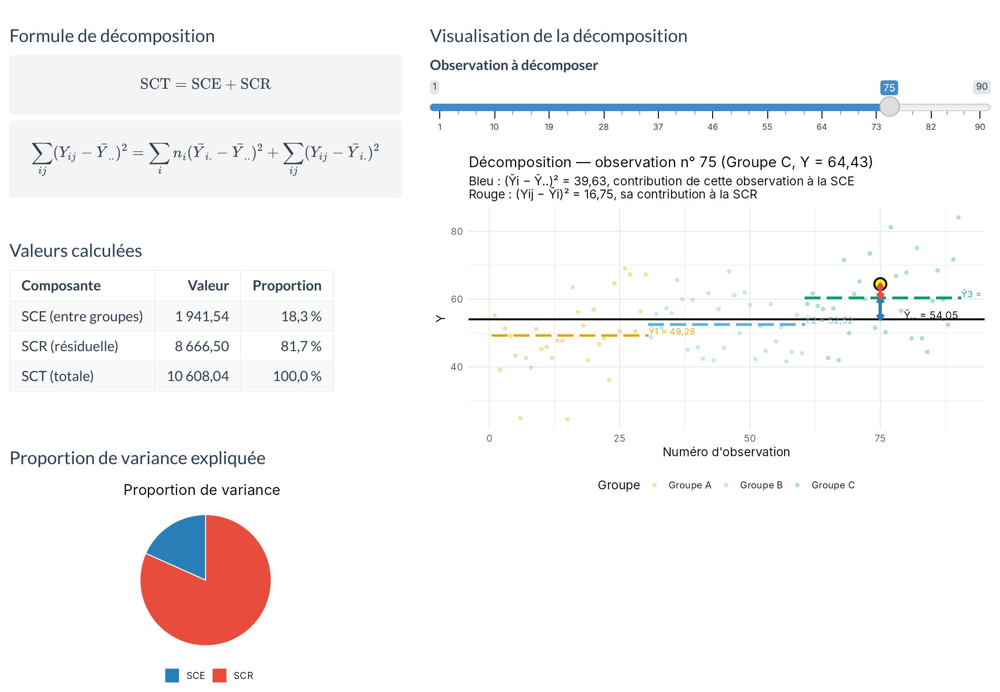

# La logique des sommes de carrés {#sec-decomposer}

```{r}
#| include: false
source("_common.R")
# Petit exemple travaillé
ex <- data.frame(groupe = factor(rep(c("Groupe A", "Groupe B", "Groupe C"), each = 3)),
                 y = c(4, 5, 6, 5, 6, 7, 7, 8, 9))
ex_a <- anova_1f(ex)
# Observation 75 du cas fil rouge (Groupe C)
y75 <- fil$y[75]; mC <- fil_a$m[3]; gm <- fil_a$gm
# Espérance des carrés moyens : simulation vectorisée du scénario fil rouge
sim_cm <- function(mu, R = 4000, n = 30, s = 10, graine = 11) {
  set.seed(graine); k <- length(mu)
  out <- replicate(R, {
    y <- matrix(rnorm(n * k, rep(mu, each = n), s), n)
    m <- colMeans(y); g <- mean(y)
    c(cme = n * sum((m - g)^2) / (k - 1), cmr = sum((n - 1) * apply(y, 2, var)) / (k * (n - 1)))
  })
  as.data.frame(t(out))
}
s1 <- sim_cm(c(50, 54, 60)); s0 <- sim_cm(c(50, 50, 50), graine = 12)
E_cme <- 100 + 30 * sum((mu_fil - mean(mu_fil))^2) / 2
```

::: {.callout-note appearance="simple"}
## Dans ce chapitre

- définir SCT, SCE et SCR et vérifier l'identité $\mathrm{SCT}=\mathrm{SCE}+\mathrm{SCR}$;
- passer des sommes de carrés aux carrés moyens grâce aux degrés de liberté;
- refaire à la main un tableau ANOVA complet;
- comprendre ce qu'estiment $CM_E$ et $CM_R$, sous $H_0$ et sous $H_1$.
:::

> **Idée centrale.** L'écart de chaque observation à la moyenne générale se coupe en deux morceaux : l'écart de sa moyenne de groupe à la moyenne générale, et son écart à sa propre moyenne de groupe. Mis au carré et additionnés, ces morceaux donnent deux sommes qui s'additionnent exactement.

## Trois distances, une identité

L'ANOVA travaille avec des distances au carré. Pour chaque observation, on peut écrire

$$\underbrace{Y_{ij}-\bar Y_{..}}_{\text{écart total}}=\underbrace{(\bar Y_{i.}-\bar Y_{..})}_{\text{écart du groupe}}+\underbrace{(Y_{ij}-\bar Y_{i.})}_{\text{écart résiduel}} .$$

En élevant au carré et en sommant sur toutes les observations, on obtient la partition fondamentale :

$$\underbrace{\sum_i\sum_j(Y_{ij}-\bar Y_{..})^2}_{\mathrm{SCT}}
=\underbrace{\sum_i n_i(\bar Y_{i.}-\bar Y_{..})^2}_{\mathrm{SCE}}
+\underbrace{\sum_i\sum_j(Y_{ij}-\bar Y_{i.})^2}_{\mathrm{SCR}}.$$ {#eq-partition}

La somme des carrés totale (SCT) représente la variabilité globale. La somme des carrés entre groupes (SCE) représente la part associée aux différences entre les moyennes de groupes. La somme des carrés résiduelle (SCR) représente la dispersion des observations autour de leur propre moyenne de groupe.

Pourquoi les carrés s'additionnent-ils? Le développement du carré fait apparaître un terme croisé, $2\sum_i(\bar Y_{i.}-\bar Y_{..})\sum_j(Y_{ij}-\bar Y_{i.})$. Or, dans chaque groupe, les écarts à la moyenne du groupe totalisent zéro : $\sum_j(Y_{ij}-\bar Y_{i.})=0$. Le terme croisé disparaît donc **pour l'ensemble des données**, mais pas pour une observation prise isolément, ce que la section « Dans l'application » permettra de vérifier.

Cette identité est algébrique, non probabiliste : elle est vraie dans tout jeu de données. Ce sont les postulats du modèle qui permettent ensuite d'utiliser le rapport $F$ comme test d'inférence.

## Des sommes de carrés aux carrés moyens

Une somme des carrés augmente mécaniquement avec le nombre de termes additionnés. On la divise donc par ses **degrés de liberté**, le nombre d'écarts qui peuvent varier librement :

- les $k$ moyennes de groupe sont liées par leur moyenne pondérée, qui doit redonner $\bar Y_{..}$ : il reste $k-1$ écarts libres;
- dans chaque groupe, les $n_i$ écarts totalisent zéro : il en reste $n_i-1$ libres, soit $N-k$ au total;
- pour SCT, $N-1$, et l'on vérifie que $(k-1)+(N-k)=N-1$.

$$CM_E=\frac{\mathrm{SCE}}{k-1},\qquad CM_R=\frac{\mathrm{SCR}}{N-k},\qquad F=\frac{CM_E}{CM_R}.$$

$CM_R$ est la **variance groupée** : une moyenne des variances de groupe pondérée par leurs degrés de liberté, $CM_R=\sum_i(n_i-1)s_i^2/(N-k)$. Avec des groupes égaux, c'est la simple moyenne des $s_i^2$.

## Exemple numérique entièrement travaillé

Considérons volontairement de très petits groupes. Le but est de voir le mécanisme; ce n'est pas un modèle de taille d'échantillon à reproduire.

| Groupe | Scores | Moyenne de groupe |
|:--|:--|--:|
| A | 4, 5, 6 | 5 |
| B | 5, 6, 7 | 6 |
| C | 7, 8, 9 | 8 |

: Données de l'exemple travaillé. {#tbl-ex}

```{r}
#| label: fig-trois-distances
#| fig-cap: "L'exemple travaillé. Ligne grise : la moyenne générale (6,33). Traits colorés : les moyennes de groupe. Pour l'observation entourée (Y = 9, Groupe C), l'écart total de 2,67 se coupe en un écart du groupe (1,67, flèche verticale noire) et un écart résiduel (1, flèche colorée)."
#| fig-height: 3.4
ex$x <- as.numeric(ex$groupe) + rep(c(-0.12, 0, 0.12), 3)
moy <- data.frame(groupe = levels(ex$groupe), m = ex_a$m, x = 1:3)
ggplot(ex, aes(x, y, colour = groupe)) +
  geom_hline(yintercept = ex_a$gm, colour = "grey55", linewidth = 0.8) +
  geom_segment(data = moy, aes(x = x - 0.3, xend = x + 0.3, y = m, yend = m), linewidth = 1.2) +
  geom_point(size = 3) +
  geom_point(data = ex[9, ], shape = 21, size = 6, colour = "black", stroke = 0.8) +
  annotate("segment", x = 3.42, xend = 3.42, y = ex_a$gm, yend = 8, colour = "black",
           arrow = arrow(length = unit(0.12, "cm"), ends = "both")) +
  annotate("segment", x = 3.2, xend = 3.2, y = 8, yend = 9, colour = PALETTE[3],
           arrow = arrow(length = unit(0.12, "cm"), ends = "both")) +
  annotate("text", x = 3.47, y = 7.2, label = "1,67", hjust = 0, size = 3.5) +
  annotate("text", x = 3.25, y = 8.5, label = "1", hjust = 0, size = 3.5, colour = PALETTE[3]) +
  annotate("text", x = 0.6, y = ex_a$gm + 0.22, label = "moyenne générale 6,33", hjust = 0,
           size = 3.3, colour = "grey40") +
  scale_colour_manual(values = PALETTE[1:3], guide = "none") +
  scale_x_continuous(breaks = 1:3, labels = levels(ex$groupe), limits = c(0.55, 3.75)) +
  scale_y_continuous(breaks = 3:10, labels = axe_fr) +
  labs(x = NULL, y = "Score")
```

La moyenne générale est $\bar Y_{..}=57/9=6{,}33$. Chaque groupe contient trois observations. La somme des carrés entre groupes est donc

$$\mathrm{SCE}=3(5-6{,}33)^2+3(6-6{,}33)^2+3(8-6{,}33)^2=5{,}33+0{,}33+8{,}33=14.$$

À l'intérieur de chacun des groupes, les écarts à la moyenne sont $-1$, $0$ et $1$; leur carré total vaut 2. Pour les trois groupes, $\mathrm{SCR}=2+2+2=6$. On vérifie directement que $\mathrm{SCT}=\sum(Y_{ij}-6{,}33)^2=20=14+6$.

| Source | SC | ddl | CM | $F$ |
|:--|--:|--:|--:|--:|
| Entre groupes (SCE) | 14 | 2 | 7 | 7 |
| Résiduelle (SCR) | 6 | 6 | 1 | |
| Totale (SCT) | 20 | 8 | | |

: Tableau ANOVA de l'exemple travaillé. {#tbl-ex-anova}

Le rapport est élevé parce que les centres des groupes diffèrent davantage que les scores ne se dispersent autour de leur propre centre. Avec 2 et 6 degrés de liberté, $F=7$ correspond à $`r pvm(ex_a$p)`$. Dans cet exemple, $\eta^2=14/20=0{,}70$; cette grande valeur est attendue, car les données ont été choisies pour rendre le calcul transparent.

## Ce qu'estiment les carrés moyens

Pourquoi comparer $CM_E$ à $CM_R$? Parce que, sous les postulats du modèle, leurs **espérances** (leurs valeurs moyennes sur un grand nombre d'échantillons) sont :

$$E(CM_R)=\sigma^2,\qquad E(CM_E)=\sigma^2+\frac{\sum_i n_i\tau_i^2}{k-1}.$$ {#eq-ecm}

$CM_R$ estime toujours la variance d'erreur $\sigma^2$, que $H_0$ soit vraie ou non : il ne regarde que la dispersion à l'intérieur des groupes. $CM_E$ estime $\sigma^2$ **plus** un terme qui ne vaut zéro que si tous les $\tau_i$ sont nuls. Ainsi :

- sous $H_0$, les deux carrés moyens estiment la même quantité et $F$ fluctue autour de 1;
- sous $H_1$, $CM_E$ tend à dépasser $CM_R$, d'autant plus que les effets $\tau_i$ et les effectifs $n_i$ sont grands.

Pourquoi $CM_E$ estime-t-il $\sigma^2$ sous $H_0$? Une moyenne de $n$ observations a une variance $\sigma^2/n$. Si toutes les moyennes de population sont égales, la variance des $\bar Y_{i.}$ estime donc $\sigma^2/n$, et la multiplier par $n$ (c'est ce que fait SCE) redonne $\sigma^2$.

::: {.case}
Dans le scénario du cas fil rouge, $\sum_i n_i\tau_i^2 = 30\,(4{,}67^2+0{,}67^2+5{,}33^2)=1\,520$, d'où
$$E(CM_E)=100+\frac{1\,520}{2}=`r frm(E_cme, 0)`,\qquad E(CM_R)=100.$$
Notre échantillon donne $CM_E=`r frm(fil_a$cme)`$ et $CM_R=`r frm(fil_a$cmr)`$ : deux réalisations proches de leurs espérances, mais pas égales à elles.
:::

```{r}
#| label: fig-ecm
#| fig-cap: "Distribution de $CM_E$ et de $CM_R$ sur 4 000 échantillons simulés (3 groupes de 30, σ = 10). Traits pointillés : les espérances données par l'équation. Sous $H_0$, les deux distributions sont centrées sur 100; dans le scénario du cas fil rouge, seule celle de $CM_E$ se déplace, vers 860."
#| fig-height: 4.6
dd <- rbind(data.frame(scen = "Sous H0 : μ = 50, 50, 50", stat = rep(c("CM_E", "CM_R"), each = nrow(s0)), v = c(s0$cme, s0$cmr)),
            data.frame(scen = "Cas fil rouge : μ = 50, 54, 60", stat = rep(c("CM_E", "CM_R"), each = nrow(s1)), v = c(s1$cme, s1$cmr)))
dd$scen <- factor(dd$scen, levels = unique(dd$scen))
esp <- data.frame(scen = factor(levels(dd$scen), levels = levels(dd$scen)), e = c(100, E_cme))
ggplot(dd, aes(v, fill = stat)) +
  geom_histogram(binwidth = 25, boundary = 0, position = "identity", alpha = 0.6) +
  geom_vline(xintercept = 100, linetype = 2, colour = PALETTE[2]) +
  geom_vline(data = esp, aes(xintercept = e), linetype = 2, colour = PALETTE[1]) +
  facet_wrap(~scen, ncol = 1, scales = "free_y") +
  scale_fill_manual(values = c(CM_E = PALETTE[1], CM_R = PALETTE[2]), name = NULL,
                    labels = c(expression(CM[E]), expression(CM[R]))) +
  scale_x_continuous(labels = axe_fr, limits = c(0, 2200)) + scale_y_continuous(labels = axe_fr) +
  labs(x = "Valeur du carré moyen", y = "Nombre d'échantillons")
```

La @fig-ecm le montre par simulation. Sur 4 000 échantillons, la moyenne des $CM_R$ vaut `r fr(mean(s1$cmr), 1)` et celle des $CM_E$ vaut `r fr(mean(s1$cme), 1)` dans le scénario du cas fil rouge, très proches de 100 et de `r fr(E_cme, 0)`. On remarque aussi que $CM_E$ est beaucoup plus variable que $CM_R$ : il ne repose que sur 2 degrés de liberté, contre 87.

## Dans l'application

{#fig-cap-decomposition .capture}

L'onglet **Décomposition** (@fig-cap-decomposition) affiche les trois sommes de carrés du cas fil rouge : $\mathrm{SCE}=`r frm(fil_a$sce)`$ (`r pc(fil_a$eta2)`), $\mathrm{SCR}=`r frm(fil_a$scr)`$ et $\mathrm{SCT}=`r frm(fil_a$sct)`$. Le graphique place chaque observation selon son numéro, avec la moyenne générale (ligne noire) et les moyennes de groupe (tirets colorés).

::: {.app-step}
Ouvrez **Analyse ▸ Décomposition** et réglez le curseur **Observation à décomposer** à 75. Il s'agit d'une personne du Groupe C dont le score vaut `r fr(y75)`. Le sous-titre du graphique donne sa contribution à SCE, $(\bar Y_{i.}-\bar Y_{..})^2=`r frm((mC - gm)^2)`$, et à SCR, $(Y_{ij}-\bar Y_{i.})^2=`r frm((y75 - mC)^2)`$.
:::

Additionnons : `r fr((mC - gm)^2)` + `r fr((y75 - mC)^2)` = `r fr((mC - gm)^2 + (y75 - mC)^2)`. Or la contribution de cette observation à SCT est $(`r frm(y75)`-`r frm(gm)`)^2=`r frm((y75 - gm)^2)`$. La différence, `r fr((y75 - gm)^2 - (mC - gm)^2 - (y75 - mC)^2)`, est le terme croisé $2(\bar Y_{i.}-\bar Y_{..})(Y_{ij}-\bar Y_{i.})$. Il est positif ici parce que l'observation et sa moyenne de groupe se situent toutes deux au-dessus de la moyenne générale; pour une observation du Groupe C située sous 60,34, il serait négatif. Sommés sur tout le groupe, ces termes s'annulent : l'identité [-@eq-partition] vaut pour les totaux, pas observation par observation.

## Laboratoire

::: {.app-step}
Dans le cas fil rouge, doublez les trois écarts-types (20 au lieu de 10) en gardant la graine 2026. Avant de regarder **Décomposition**, prédisez : SCE va-t-il changer? SCR va-t-il doubler, quadrupler, ou rester stable?
:::

::: {.callout-tip collapse="true"}
## Réponse

Avec la même graine, chaque écart individuel $\varepsilon_{ij}$ est multiplié par 2. Les écarts résiduels doublent, donc **SCR quadruple** : il passe de `r fr(fil_a$scr)` à `r fr(bruit_a$scr)`. SCE change aussi, bien que les moyennes de population n'aient pas bougé : les moyennes **observées** contiennent une part d'erreur d'échantillonnage, qui double elle aussi. SCE passe de `r fr(fil_a$sce)` à `r fr(bruit_a$sce)`. La part de SCE dans SCT chute de `r pc(fil_a$eta2)` à `r pc(bruit_a$eta2)`.
:::

## À retenir

- $\mathrm{SCT}=\mathrm{SCE}+\mathrm{SCR}$ est une identité algébrique, valable pour les totaux.
- Les degrés de liberté se partagent de la même façon : $N-1=(k-1)+(N-k)$.
- $CM_R$ est la variance groupée; il estime $\sigma^2$ que $H_0$ soit vraie ou non.
- $CM_E$ estime $\sigma^2+\sum n_i\tau_i^2/(k-1)$ : il ne dépasse systématiquement $CM_R$ que si les moyennes de population diffèrent.
- $F=CM_E/CM_R$ fluctue autour de 1 sous $H_0$ et grandit avec l'effet et les effectifs.

## Quiz

1. Dans une étude, $\mathrm{SCT}=500$ et $\mathrm{SCR}=380$. Que vaut SCE?
2. Avec $k=4$ groupes de 25, quels sont les degrés de liberté de SCE, SCR et SCT?
3. Avec les réponses précédentes, calculez $CM_E$, $CM_R$ et $F$.
4. Si l'on ajoute 10 points à toutes les observations du Groupe A seulement, lesquelles de SCE et SCR changent?
5. Pourquoi $CM_R$ estime-t-il $\sigma^2$ même lorsque $H_0$ est fausse?

::: {.callout-tip collapse="true"}
## Réponses du quiz

1. $\mathrm{SCE}=500-380=120$.
2. $k-1=3$, $N-k=96$, $N-1=99$.
3. $CM_E=120/3=40$, $CM_R=380/96=3{,}96$, $F=40/3{,}96=10{,}1$.
4. SCE seulement : les écarts à la moyenne du Groupe A ne changent pas, mais sa moyenne s'éloigne (ou se rapproche) des autres.
5. Parce qu'il mesure la dispersion autour de chaque moyenne de groupe; les différences entre moyennes n'y entrent pas.
:::
