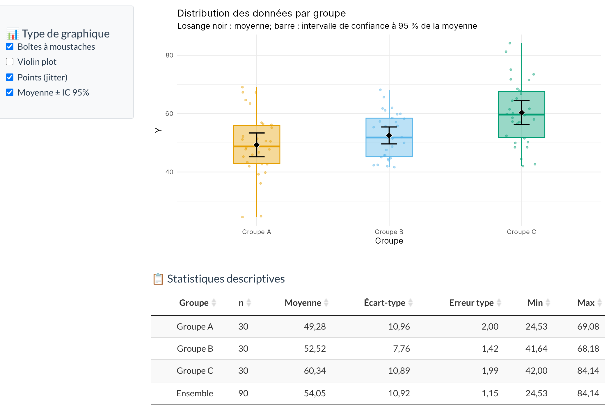

# Des données simulées à leur description {#sec-donnees}

```{r}
#| include: false
source("_common.R")
# 20 réalisations du même scénario (graines 2026 à 2045)
reps <- do.call(rbind, lapply(2026:2045, function(g) {
  a <- anova_1f(simuler(graine = g))
  data.frame(graine = g, groupe = names(a$m), m = unname(a$m), s = unname(a$s), F = a$F, p = a$p)
}))
et_th <- 10 / sqrt(30)
ic <- function(i) fil_a$m[i] + c(-1, 1) * qt(.975, 29) * fil_a$s[i] / sqrt(30)
n_sig <- sum(tapply(reps$p, reps$graine, unique) < 0.05)
```

::: {.callout-note appearance="simple"}
## Dans ce chapitre

- distinguer les paramètres du scénario ($\mu_i$, $\sigma_i$) des statistiques de l'échantillon ($\bar Y_i$, $s_i$);
- mesurer l'aléa d'échantillonnage d'une moyenne par son erreur type;
- lire boîtes à moustaches, points et intervalles de confiance avant tout test;
- choisir une transformation de Y pour une raison défendable, et non pour le résultat qu'elle donne.
:::

> **Idée centrale.** Un échantillon est une réalisation parmi d'autres du même scénario. Avant de demander si les moyennes diffèrent, il faut voir ce que les données montrent et savoir de combien une moyenne observée peut s'écarter de sa valeur de population par le seul hasard.

## Une simulation est un échantillon, non la population

Les paramètres $\mu_i$ et $\sigma_i$ définis dans le panneau latéral ne sont pas reproduits exactement dans les données simulées. Chaque tirage produit des observations aléatoires; les moyennes et écarts-types descriptifs fluctuent donc. Cette différence est précisément ce qui donne un sens à l'inférence : l'échantillon contient de l'information, mais aussi de l'aléa.

Une graine fixe permet de retrouver le même échantillon. Le bouton **🎲 Nouvel échantillon** tire une nouvelle graine, donc une autre réalisation du même scénario théorique. Pour apprendre, gardez la même graine pendant que vous modifiez un seul paramètre; sinon, deux changements se confondent.

```{r}
#| label: fig-reps
#| fig-cap: "Vingt échantillons du cas fil rouge (graines 2026 à 2045). Chaque point est une moyenne de groupe observée; les tirets marquent les moyennes de population 50, 54 et 60. Les points encerclés proviennent de la graine 2026, l'échantillon utilisé dans le manuel."
#| fig-height: 3.4
set.seed(5)
reps$x <- as.numeric(factor(reps$groupe)) + runif(nrow(reps), -0.18, 0.18)
ggplot(reps, aes(x, m, colour = groupe)) +
  geom_segment(data = data.frame(i = 1:3, mu = mu_fil), aes(x = i - 0.3, xend = i + 0.3, y = mu, yend = mu),
               inherit.aes = FALSE, linetype = 2, linewidth = 0.8) +
  geom_point(size = 2.4, alpha = 0.85) +
  geom_point(data = subset(reps, graine == 2026), shape = 21, size = 5, colour = "black", stroke = 0.8) +
  scale_colour_manual(values = PALETTE[1:3], guide = "none") +
  scale_x_continuous(breaks = 1:3, labels = paste("Groupe", LETTERS[1:3])) +
  scale_y_continuous(labels = axe_fr) +
  labs(x = NULL, y = "Moyenne observée")
```

La @fig-reps montre l'ampleur de cet aléa. Sur vingt réalisations, la moyenne du Groupe A varie de `r fr(min(reps$m[reps$groupe == "Groupe A"]))` à `r fr(max(reps$m[reps$groupe == "Groupe A"]))`, alors que la moyenne de population vaut toujours 50. Cette dispersion est prévisible : la moyenne de $n$ observations indépendantes a pour écart-type, appelé **erreur type**,

$$\sigma_{\bar Y}=\frac{\sigma}{\sqrt n}=\frac{10}{\sqrt{30}}=`r frm(et_th)` .$$

Environ 95 % des moyennes observées tombent donc à moins de $2\times`r frm(et_th)`\approx `r frm(2 * et_th, 1)`$ points de leur valeur de population. Dans l'échantillon de la graine 2026, le Groupe A est un peu sous 50 et le Groupe B un peu sous 54 : rien d'anormal. Sur ces vingt échantillons, le test $F$ est significatif `r n_sig` fois; ce taux de détection est une première idée de la **puissance** du plan (chapitre [-@sec-effet]).

## Lire le tableau descriptif

{#fig-cap-donnees .capture}

Le tableau de la @fig-cap-donnees réunit, pour chaque groupe et pour l'ensemble : l'effectif, la moyenne, l'écart-type, l'erreur type $s_i/\sqrt{n_i}$, le minimum et le maximum. Trois lectures s'imposent avant tout test.

- **Les centres.** Les moyennes s'ordonnent comme dans la population (A < B < C), avec un écart de `r fr(fil_a$m[3] - fil_a$m[1])` points entre A et C et de `r fr(fil_a$m[2] - fil_a$m[1])` points seulement entre A et B.
- **Les dispersions.** Les écarts-types observés (`r fr(fil_a$s[1])`, `r fr(fil_a$s[2])`, `r fr(fil_a$s[3])`) diffèrent alors que les trois $\sigma_i$ valent 10. Un rapport de `r fr(max(fil_a$s) / min(fil_a$s))` entre le plus grand et le plus petit est banal avec 30 observations par groupe; le chapitre [-@sec-postulats] apprend à en juger.
- **Les valeurs extrêmes.** Le Groupe A contient deux scores près de 25, bien sous le reste du groupe. Ils sont plausibles pour une loi normale de moyenne 50 et d'écart-type 10 (environ 2,5 écarts-types), mais ce sont eux qui gonflent l'écart-type du groupe.

L'écart-type de la ligne **Ensemble** (`r fr(sqrt(fil_a$sct / 89))`) est celui de toutes les observations réunies, sans tenir compte des groupes. Son carré, `r fr(fil_a$sct / 89)`, n'est autre que $\mathrm{SCT}/(N-1)$ : il contient à la fois la variabilité inter et la variabilité intra.

## Lire le graphique avant le test

Les boîtes à moustaches, violons et points individuels montrent trois éléments que la seule moyenne masque : le centre, la dispersion et les valeurs inhabituelles. La boîte couvre la moitié centrale des observations et sa ligne marque la médiane; les points rendent visible chaque personne, ce qui empêche une boîte de cacher un petit groupe ou des valeurs groupées.

Le losange noir et sa barre représentent la moyenne et son intervalle de confiance à 95 %, $\bar Y_i\pm t_{0{,}975;\,n_i-1}\,s_i/\sqrt{n_i}$. Pour le Groupe A, $49{,}28\pm 2{,}045\times 2{,}00$, soit [`r fr(ic(1)[1])` ; `r fr(ic(1)[2])`].

::: {.callout-warning}
## Le chevauchement des intervalles n'est pas un test

Deux intervalles à 95 % qui **ne se chevauchent pas** signalent une différence nette (au seuil d'environ 0,006 pour deux groupes de même erreur type). En revanche, deux intervalles **qui se chevauchent** peuvent correspondre à une différence significative : la règle est trop conservatrice. La raison : l'erreur type d'une **différence** de deux moyennes, $\sqrt{s_1^2/n_1+s_2^2/n_2}$, est plus petite que la somme des deux erreurs types que l'œil additionne en comparant les barres. Dans le cas fil rouge, l'intervalle de B se termine à `r fr(ic(2)[2])` et celui de C commence à `r fr(ic(3)[1])` : ils sont disjoints de justesse, et leur différence sera jugée significative au chapitre [-@sec-comparaisons]. Pour comparer des moyennes, on utilise une procédure définie, pas l'œil.
:::

Décrivez d'abord ce que vous voyez, en langage substantiel. Par exemple : « Le score moyen augmente du dispositif A au dispositif C, l'écart le plus net séparant C des deux autres. Les dispersions sont comparables; deux scores faibles se démarquent dans le groupe A. » Ce commentaire guide ensuite le choix des diagnostics et des comparaisons.

## Transformations : une solution conditionnelle

L'application permet plusieurs transformations de Y. Une transformation change l'échelle de la variable; elle ne corrige ni une erreur de mesure ni une absence d'indépendance. Avant d'en utiliser une, vérifiez qu'elle est définie et interprétable pour votre variable.

| Transformation | Domaine exigé | Situation typique |
|:--|:--|:--|
| $\sqrt Y$ | $Y \geq 0$ | comptages; variance proportionnelle à la moyenne |
| $\ln Y$, $\log_{10} Y$ | $Y > 0$ | durées, revenus, concentrations; écart-type proportionnel à la moyenne |
| $1/\sqrt Y$ | $Y > 0$ | asymétrie positive très forte |
| $Y^2$ | aucun | asymétrie négative (rarement utile) |
| $\arcsin\sqrt Y$ | $0 \leq Y \leq 1$ | proportions |

: Les transformations offertes par l'application. {#tbl-transfo}

Un logarithme, par exemple, fait passer la comparaison d'écarts additifs à une lecture plus proche de **rapports** : une différence de 0,1 en $\ln Y$ correspond à des moyennes géométriques dont le rapport est d'environ 1,1. Les résultats doivent alors être rapportés sur cette échelle, ou retraduits.

Si les données sortent du domaine exigé, l'application l'indique sous la liste et conserve Y brut pour toutes les analyses. C'est le cas de $\arcsin\sqrt Y$ avec le cas fil rouge : des scores sur 100 ne sont pas des proportions. Il faudrait d'abord les diviser par 100, ce que l'application ne fait pas d'elle-même.

::: {.callout-warning}
## Ne pas chercher la transformation qui « donne p < 0,05 »

La décision de transformation doit répondre à une caractéristique de la mesure ou à un diagnostic, non à l'issue désirée du test. Si plusieurs choix sont plausibles, documentez-les et vérifiez que la conclusion ne dépend pas artificiellement d'un seul choix. Notez aussi que les données de l'application sont simulées selon des lois normales de même variance : les transformer ne peut, en moyenne, que dégrader le respect des postulats. L'option sert à observer l'effet d'un changement d'échelle, pas à « réparer » ces données.
:::

## Dans l'application

::: {.app-step}
Dans **Données ▸ Données simulées**, cochez successivement **Boîtes à moustaches**, **Violin plot**, **Points (jitter)** et **Moyenne ± IC 95%**. Gardez la graine 2026. Déplacez seulement la moyenne du Groupe C, puis seulement son écart-type. Expliquez ce qui change dans les graphiques et dans le tableau descriptif.
:::

::: {.app-step}
Cliquez ensuite cinq fois sur **🎲 Nouvel échantillon** en notant à chaque fois les trois moyennes. Comparez leur variation à l'erreur type de `r fr(et_th)`. Inscrivez enfin 2026 dans **Graine** pour revenir au cas fil rouge.
:::

## Laboratoire

::: {.app-step}
Partez du cas fil rouge et faites passer **n par groupe** de 30 à 120, sans changer la graine. Avant de regarder, prédisez : l'écart-type de chaque groupe va-t-il diminuer? Et la largeur des intervalles de confiance?
:::

::: {.callout-tip collapse="true"}
## Réponse

Les écarts-types observés ne diminuent pas : ils restent proches de $\sigma=10$ (ils s'en rapprochent même, car ils sont estimés avec plus de données). Ce qui diminue, c'est l'**erreur type** $s/\sqrt n$, qui est divisée par environ $\sqrt{4}=2$ : elle passe d'environ 1,8 à environ 0,9, et les intervalles de confiance deviennent deux fois plus étroits. Un grand échantillon ne rend pas les personnes plus semblables entre elles; il rend les **moyennes** plus précises. Remettez ensuite 30 par groupe.
:::

## À retenir

- Les paramètres ($\mu_i$, $\sigma_i$) décrivent le scénario; les statistiques ($\bar Y_i$, $s_i$) décrivent un échantillon et fluctuent d'un échantillon à l'autre.
- L'erreur type $\sigma/\sqrt n$ mesure cette fluctuation pour une moyenne; elle diminue avec $\sqrt n$.
- Décrire centres, dispersions et valeurs inhabituelles précède tout test.
- Le chevauchement d'intervalles de confiance n'est pas une procédure de comparaison.
- Une transformation se justifie par la nature de la mesure, se vérifie par son domaine, et se rapporte sur sa propre échelle.

## Quiz

1. Le Groupe B a un écart-type observé de `r fr(fil_a$s[2])` alors que $\sigma_B=10$. Est-ce une erreur de l'application?
2. Que vaut l'erreur type d'une moyenne de 25 observations si $\sigma=15$?
3. Deux intervalles de confiance à 95 % se chevauchent légèrement. Peut-on conclure que les moyennes ne diffèrent pas significativement?
4. Pourquoi l'application refuse-t-elle $\ln Y$ si une observation vaut $-2$?
5. Quelle est la différence entre l'écart-type de la ligne **Ensemble** et $\sqrt{CM_R}$?

::: {.callout-tip collapse="true"}
## Réponses du quiz

1. Non. C'est l'aléa d'échantillonnage : avec 30 observations, un écart-type observé de 7,8 pour $\sigma=10$ est plausible.
2. $15/\sqrt{25}=3$.
3. Non. Le chevauchement est compatible avec une différence significative; il faut un test ou une procédure de comparaison.
4. Le logarithme n'est défini que pour des valeurs strictement positives.
5. L'écart-type de l'ensemble inclut les différences entre groupes ($\sqrt{\mathrm{SCT}/(N-1)}$); $\sqrt{CM_R}$ ne mesure que la dispersion à l'intérieur des groupes (`r fr(sqrt(fil_a$cmr))` dans le cas fil rouge).
:::
