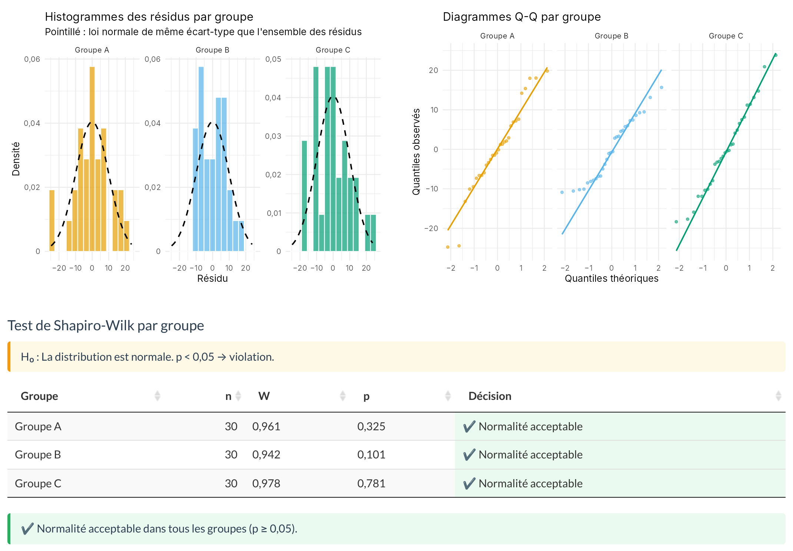
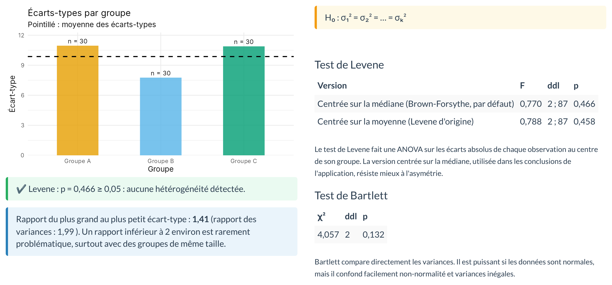
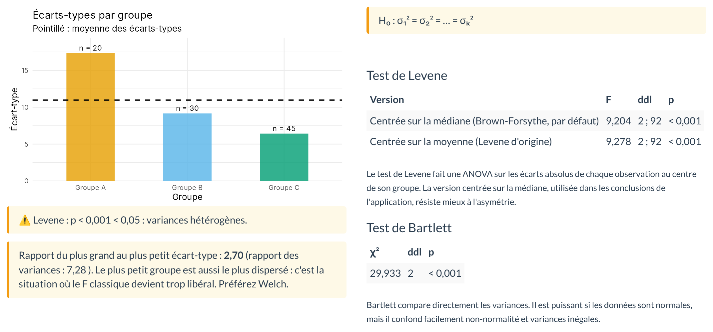
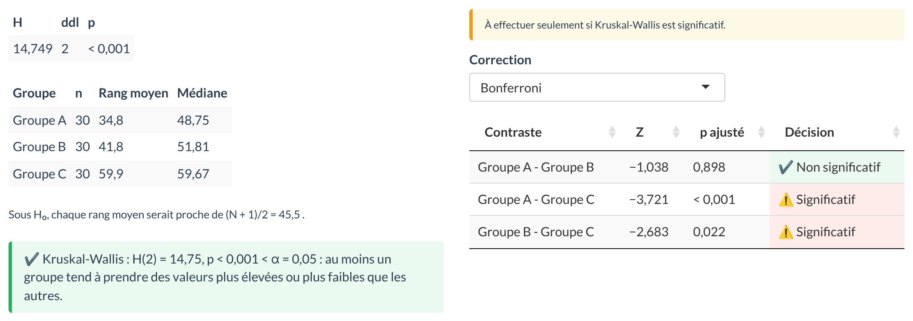

# Évaluer les postulats avec jugement {#sec-postulats}

```{r}
#| include: false
source("_common.R")
lev_fil <- levene_med(fil); lev_het <- levene_med(het)
bart_fil <- bartlett.test(y ~ groupe, data = fil); bart_het <- bartlett.test(y ~ groupe, data = het)
sw <- sapply(split(fil$y - ave(fil$y, fil$groupe), fil$groupe), function(r) shapiro.test(r)$p.value)
kw <- kruskal.test(y ~ groupe, data = fil)
rangs <- tapply(rank(fil$y), fil$groupe, mean)
# Seuil réel du F classique et de Welch : simulation sous H0 (toutes les moyennes égales)
alpha_reel <- function(ns, sds, R = 4000, graine = 21) {
  set.seed(graine); k <- length(ns); g <- rep(seq_len(k), ns); N <- sum(ns)
  res <- replicate(R, {
    y <- rnorm(N, 50, rep(sds, ns))
    m <- tapply(y, g, mean); v <- tapply(y, g, var); gm <- mean(y)
    Fc <- (sum(ns * (m - gm)^2) / (k - 1)) / (sum((ns - 1) * v) / (N - k))
    w <- ns / v; mw <- sum(w * m) / sum(w); h <- sum((1 - w / sum(w))^2 / (ns - 1))
    Fw <- (sum(w * (m - mw)^2) / (k - 1)) / (1 + 2 * (k - 2) * h / (k^2 - 1))
    c(pf(Fc, k - 1, N - k, lower.tail = FALSE) < .05, pf(Fw, k - 1, (k^2 - 1) / (3 * h), lower.tail = FALSE) < .05)
  })
  rowMeans(res)
}
scen_a <- list(
  list(nom = "Variances égales\nn = 30, 30, 30", ns = c(30, 30, 30), sd = c(10, 10, 10)),
  list(nom = "σ = 18, 10, 6\nn = 30, 30, 30", ns = c(30, 30, 30), sd = c(18, 10, 6)),
  list(nom = "σ = 18, 10, 6\nn = 20, 30, 45", ns = c(20, 30, 45), sd = c(18, 10, 6)),
  list(nom = "σ = 6, 10, 18\nn = 20, 30, 45", ns = c(20, 30, 45), sd = c(6, 10, 18)))
ar <- do.call(rbind, lapply(scen_a, function(s) {
  r <- alpha_reel(s$ns, s$sd)
  data.frame(scen = s$nom, test = c("F classique", "Welch"), taux = r)
}))
ar$scen <- factor(ar$scen, levels = sapply(scen_a, `[[`, "nom"))
```

::: {.callout-note appearance="simple"}
## Dans ce chapitre

- examiner la normalité des résidus par graphiques plutôt que par un seul test;
- évaluer l'homogénéité des variances avec Levene, Bartlett et le rapport des écarts-types;
- comprendre, par simulation, quand l'hétérogénéité fausse réellement le test $F$;
- traiter l'indépendance comme une propriété du plan;
- savoir ce que teste Kruskal-Wallis et ce qu'il ne teste pas.
:::

> **Idée centrale.** Un postulat n'est pas une case à cocher. La bonne question n'est pas « le test du postulat est-il significatif? », mais « l'écart observé est-il assez grave, dans ce plan, pour changer la conclusion? ».

Le modèle du chapitre [-@sec-reperes] suppose des erreurs $\varepsilon_{ij}$ **indépendantes**, de **même variance** $\sigma^2$ dans tous les groupes et **normales**. Les trois postulats n'ont pas le même poids : une violation de l'indépendance est presque toujours grave; une hétérogénéité des variances l'est surtout avec des groupes inégaux; un écart modéré à la normalité est souvent sans conséquence avec des groupes de taille raisonnable.

## Normalité des résidus

L'hypothèse concerne les résidus, $e_{ij}=Y_{ij}-\bar Y_{i.}$, donc les écarts des observations à leur moyenne de groupe. Pour une ANOVA à un facteur, examiner la distribution de chaque groupe est une approximation naturelle. Histogrammes et graphiques Q-Q donnent une information plus riche qu'un test isolé.

{#fig-cap-normalite .capture}

Dans un diagramme Q-Q, chaque résidu est placé face à la valeur qu'il aurait s'il provenait exactement d'une loi normale. Des points alignés sur la droite indiquent une forme normale; une courbure en « banane » signale une asymétrie; des extrémités qui s'écartent de part et d'autre signalent des queues trop lourdes. Dans la @fig-cap-normalite, les trois nuages suivent la droite; les deux scores faibles du Groupe A se voient en bas à gauche, sans rompre l'alignement.

Le test de Shapiro-Wilk donne ici $p=$ `r fr(sw[1], 3)`, `r fr(sw[2], 3)` et `r fr(sw[3], 3)` : aucun écart n'est détecté. Il faut toutefois lire ce test avec prudence. Avec de petits groupes, il manque de puissance et laisse passer des écarts réels; avec de grands groupes, il signale des écarts minimes, sans conséquence pour l'ANOVA. Il ne mesure pas la **gravité** pratique d'un écart.

Une asymétrie légère n'est généralement pas dramatique avec des tailles de groupes modérées et comparables : le théorème central limite rend les moyennes approximativement normales. Des valeurs extrêmes, une asymétrie très forte ou de petits groupes exigent davantage de prudence.

## Homogénéité des variances

L'ANOVA classique suppose que les variances de population sont égales, puisque $CM_R$ les fusionne en une seule estimation. Trois indicateurs se complètent.

- **Le test de Levene** fait une ANOVA sur les écarts absolus $|Y_{ij}-\tilde Y_{i}|$ de chaque observation à la médiane de son groupe (version de Brown et Forsythe, par défaut dans l'application) ou à sa moyenne (version d'origine). Un groupe plus dispersé a des écarts absolus plus grands en moyenne. La version centrée sur la médiane résiste mieux à l'asymétrie.
- **Le test de Bartlett** compare directement les variances. Il est puissant sous normalité, mais peut signaler une hétérogénéité simplement parce que les distributions ne sont pas normales.
- **Le rapport du plus grand au plus petit écart-type** décrit l'ampleur de l'écart, indépendamment de la taille des groupes. Un rapport inférieur à 2 environ est rarement problématique, surtout avec des groupes égaux.

{#fig-cap-homogeneite .capture}

::: {.case}
Les trois indicateurs concordent (@fig-cap-homogeneite) : Levene, $F(2, 87)=`r frm(lev_fil[["F value"]], 3)`$, $`r pvm(lev_fil[["Pr(>F)"]])`$; Bartlett, $\chi^2(2)=`r frm(bart_fil$statistic, 3)`$, $`r pvm(bart_fil$p.value)`$; rapport des écarts-types `r fr(max(fil_a$s) / min(fil_a$s))`. Rien n'appelle une méthode robuste.
:::

Le diagnostic ne se résume pas à « Levene significatif ou non ». Regardez aussi le rapport des écarts-types, les tailles de groupes et le graphique. Une différence de variance est plus dommageable quand les effectifs sont très inégaux, et la section suivante montre pourquoi.

{#fig-cap-homog-hetero .capture}

Dans le scénario hétérogène (@fig-cap-homog-hetero), les écarts-types observés valent `r fr(het_a$s[1])`, `r fr(het_a$s[2])` et `r fr(het_a$s[3])`, pour un rapport de `r fr(max(het_a$s) / min(het_a$s))`. Levene donne $F(2, 92)=`r frm(lev_het[["F value"]], 3)`$, $`r pvm(lev_het[["Pr(>F)"]])`$. Surtout, le groupe le plus dispersé est le plus petit : c'est la configuration que l'application qualifie de piège.

## Le seuil réel quand les variances diffèrent {#sec-alpha-reel}

Que se passe-t-il, concrètement, si l'on applique le test $F$ classique à des groupes de variances inégales? Une simulation répond directement. On génère des milliers d'échantillons dans lesquels **toutes les moyennes sont égales** ($H_0$ vraie), puis on compte la proportion de tests significatifs au seuil de 0,05. Un test fiable devrait se tromper dans 5 % des cas.

```{r}
#| label: fig-alpha-reel
#| fig-cap: "Proportion de rejets de $H_0$ alors que $H_0$ est vraie (4 000 échantillons simulés par scénario, seuil nominal de 0,05, ligne pointillée). Le $F$ classique devient trop libéral quand le plus petit groupe est le plus dispersé, et trop conservateur dans le cas inverse. Le test de Welch reste près de 5 % partout."
#| fig-height: 3.8
ggplot(ar, aes(scen, taux, fill = test)) +
  geom_col(position = position_dodge(0.75), width = 0.7) +
  geom_hline(yintercept = 0.05, linetype = 2) +
  geom_text(aes(label = pc(taux)), position = position_dodge(0.75), vjust = -0.4, size = 3.2) +
  scale_fill_manual(values = c(pal$bleu, pal$or), name = NULL) +
  scale_y_continuous(labels = function(x) paste0(axe_fr(100 * x), " %"), limits = c(0, 0.16)) +
  labs(x = NULL, y = "Taux de rejet sous H0")
```

La @fig-alpha-reel est l'argument central de ce chapitre :

- avec des variances égales, les deux tests respectent le seuil;
- avec des variances inégales mais des **groupes égaux**, le $F$ classique déraille peu (`r pc(ar$taux[3])`);
- quand le **plus petit groupe est le plus dispersé**, le $F$ classique rejette $H_0$ à tort dans `r pc(ar$taux[5])` des cas, soit près de trois fois le risque annoncé : $CM_R$, dominé par les grands groupes peu dispersés, sous-estime l'erreur réelle des moyennes;
- dans la configuration inverse, il devient trop prudent (`r pc(ar$taux[7])`) et perd de la puissance.

Le test de Welch, présenté au chapitre [-@sec-inference], estime la variance de chaque groupe séparément; il reste proche de 5 % dans les quatre scénarios.

## Indépendance : un postulat de plan

L'indépendance ne se teste pas convenablement après coup avec un graphique. Elle dépend de la façon dont les données ont été obtenues : une personne par ligne, pas de mesures répétées ignorées, pas de recrutement en grappes non modélisé (des élèves d'une même classe, des patients d'un même médecin), pas de contamination entre conditions. Un graphique de résidus par ordre de collecte peut révéler une tendance temporelle, mais une apparence aléatoire ne crée pas l'indépendance.

Pourquoi est-ce grave? Des observations corrélées apportent moins d'information qu'elles n'en ont l'air. $CM_R$ et les erreurs types sous-estiment alors l'incertitude réelle, et le taux de faux positifs peut dépasser largement 5 %. Aucune correction appliquée à cette ANOVA ne règle le problème : il faut un modèle qui représente la structure (mesures répétées, modèle multiniveau).

L'onglet **Indépendance** de l'application le rappelle : les données simulées sont indépendantes par construction, et le graphique des résidus dans l'ordre des observations sert seulement d'exemple de ce qu'il faudrait examiner avec des données réelles.

## L'alternative non paramétrique : Kruskal-Wallis

Le test de Kruskal-Wallis remplace chaque observation par son **rang** dans l'ensemble des données (1 pour la plus petite, $N$ pour la plus grande), puis compare les rangs moyens des groupes. Sa statistique,

$$H=\frac{12}{N(N+1)}\sum_i n_i\left(\bar R_i-\frac{N+1}{2}\right)^2,$$

suit approximativement une loi $\chi^2$ à $k-1$ degrés de liberté sous $H_0$. Sa structure rappelle SCE : une somme pondérée des écarts carrés des rangs moyens au rang moyen général $(N+1)/2$.

{#fig-cap-kw .capture}

::: {.case}
Les rangs moyens valent `r fr(rangs[1], 1)`, `r fr(rangs[2], 1)` et `r fr(rangs[3], 1)`, autour du rang moyen général de 45,5. Le test donne $H(2)=`r frm(kw$statistic)`$, $`r pvm(kw$p.value)`$ (@fig-cap-kw). Les comparaisons de Dunn, avec la correction de Bonferroni, situent la différence entre C et chacun des deux autres groupes, comme le feront les comparaisons paramétriques du chapitre [-@sec-comparaisons].
:::

Kruskal-Wallis est utile quand Y est ordinale, ou quand une forte asymétrie et des valeurs extrêmes accompagnent de petits groupes. Il faut cependant savoir ce qu'il teste. Sans postulat supplémentaire, il compare des **distributions** : il détecte la tendance d'un groupe à produire des valeurs plus élevées que les autres. Il ne se lit comme une comparaison de médianes que si les distributions ont la même forme et la même dispersion. Il n'est donc **pas** une solution à l'hétérogénéité des variances : des dispersions très différentes le perturbent aussi.

## Réponses possibles

| Situation | Réponse raisonnable |
|:--|:--|
| Écart léger de normalité, groupes comparables, $n$ modéré | ANOVA classique, souvent robuste; décrire le diagnostic |
| Variances différentes avec groupes égaux | ANOVA classique acceptable si le rapport des écarts-types reste modéré; Welch par prudence |
| Variances très différentes, ou tailles inégales | Welch pour le test global; Games-Howell pour les paires |
| Y ordinale, ou asymétrie et valeurs extrêmes sévères avec petits groupes | Kruskal-Wallis; interpréter comme une comparaison de distributions (rangs) |
| Mesures répétées ou unités regroupées | Un modèle correspondant au plan, pas cette ANOVA pour groupes indépendants |

: Diagnostic et réponse. {#tbl-reponses}

## Dans l'application

::: {.app-step}
Allez à **Données ▸ Postulats**. Avec le cas fil rouge, parcourez les sous-onglets **Normalité**, **Homogénéité des variances**, **Indépendance** et **Non paramétrique**. Notez les résultats de Levene et le rapport des écarts-types.
:::

::: {.app-step}
Créez ensuite le scénario hétérogène : inscrivez **20; 30; 45** dans **Ou tailles précises** et réglez les écarts-types à 18, 10 et 6 (moyennes inchangées). Revenez à **Homogénéité des variances** : lisez la mise en garde, puis allez à **Analyse ▸ Tableau ANOVA** et comparez le test classique et le test de Welch.
:::

## Laboratoire

::: {.app-step}
Dans le scénario hétérogène, inversez les écarts-types (6, 10 et 18) en gardant les tailles 20, 30 et 45. Le test de Levene change-t-il beaucoup? Selon la @fig-alpha-reel, le $F$ classique est-il maintenant trop libéral ou trop prudent?
:::

::: {.callout-tip collapse="true"}
## Réponse

Levene reste nettement significatif : il détecte l'inégalité des variances, sans dire dans quel sens elle joue. Mais l'effet sur le test $F$ classique s'inverse. Le grand groupe est maintenant le plus dispersé : il domine $CM_R$, qui surestime l'erreur des petits groupes. Le $F$ classique devient **conservateur** (environ `r pc(ar$taux[7], 0)` de rejets sous $H_0$ au lieu de 5 %) et perd de la puissance. Le test de Welch reste approprié dans les deux sens. Moralité : un test du postulat ne suffit pas; il faut regarder qui, parmi les groupes, est petit et dispersé.
:::

## À retenir

- Les trois postulats n'ont pas le même poids : indépendance d'abord, homogénéité ensuite (surtout avec des groupes inégaux), normalité enfin.
- Les graphiques Q-Q informent davantage que le test de Shapiro-Wilk, qui dépend fortement de $n$.
- Levene (médiane) est le test d'homogénéité de référence; le rapport des écarts-types en décrit l'ampleur.
- Petit groupe très dispersé : le $F$ classique devient trop libéral; Welch corrige ce problème.
- Kruskal-Wallis compare des rangs, donc des distributions; il ne règle pas l'hétérogénéité.

## Quiz

1. Le test de Shapiro-Wilk est significatif ($p=0{,}03$) pour un groupe de 200 observations dont le Q-Q plot est presque rectiligne. Faut-il abandonner l'ANOVA?
2. Que mesure le test de Levene, concrètement?
3. Groupes de 50, 50 et 50; écarts-types 9, 10 et 12. Inquiétude?
4. Groupes de 12, 40 et 40; écarts-types 20, 10 et 10. Quel test global choisir?
5. Des élèves de six classes sont assignés à trois méthodes, par classe entière. Quel postulat est en cause?

::: {.callout-tip collapse="true"}
## Réponses du quiz

1. Non. Avec 200 observations, le test détecte des écarts minimes; le graphique indique qu'ils sont sans conséquence, et la moyenne d'un groupe de 200 est très proche de la normalité.
2. Il fait une ANOVA sur les écarts absolus des observations à la médiane (ou à la moyenne) de leur groupe : il compare la dispersion moyenne des groupes.
3. Peu : groupes égaux et rapport de 1,33. L'ANOVA classique convient.
4. Welch : le plus petit groupe est aussi le plus dispersé, la configuration où le $F$ classique devient trop libéral.
5. L'indépendance : les élèves d'une même classe partagent un enseignant et un contexte. L'unité d'assignation est la classe; il faut un modèle multiniveau.
:::
