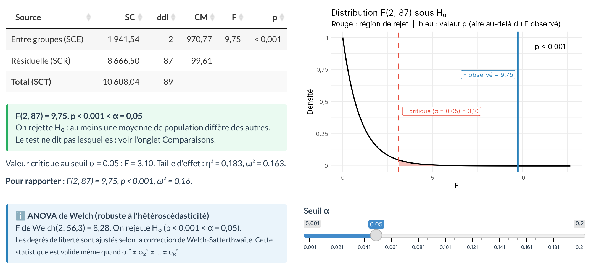
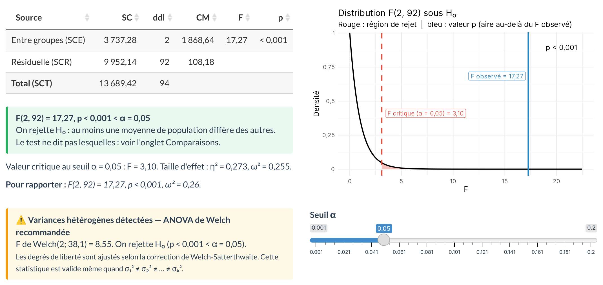

# Le tableau ANOVA et le test F {#sec-inference}

```{r}
#| include: false
source("_common.R")
w_het <- welch(het); w_fil <- welch(fil); w_bruit <- welch(bruit)
fcrit <- qf(0.95, 2, 87)
lam <- 90 * f_fil_th^2
puiss_fil <- pf(fcrit, 2, 87, ncp = lam, lower.tail = FALSE)
# Welch à la main pour le scénario hétérogène
wi <- het_a$n / het_a$v; mw <- sum(wi * het_a$m) / sum(wi)
```

::: {.callout-note appearance="simple"}
## Dans ce chapitre

- lire un tableau ANOVA dans le bon ordre et en vérifier chaque case;
- situer un $F$ observé dans sa distribution sous $H_0$ et interpréter la valeur $p$;
- voir comment la distribution de $F$ se déplace quand $H_0$ est fausse;
- savoir quand l'ANOVA de Welch remplace le test classique;
- rédiger un résultat complet.
:::

> **Idée centrale.** $F$ répond à une seule question : les moyennes de groupe sont-elles plus éloignées les unes des autres que ne le laisserait prévoir la dispersion à l'intérieur des groupes? La valeur $p$ dit à quel point un tel $F$ serait surprenant si toutes les moyennes de population étaient égales.

## Lire le tableau dans le bon ordre

Un tableau ANOVA comprend les sources de variation, leurs sommes de carrés, degrés de liberté, carrés moyens, la statistique $F$ et sa valeur $p$. Une lecture solide suit ce chemin : (1) décrire les moyennes et les dispersions, (2) examiner les postulats, (3) lire $F$ avec ses degrés de liberté, (4) rapporter la valeur $p$ et une taille d'effet, (5) seulement ensuite déterminer quelles différences sont pertinentes.

{#fig-cap-anova .capture}

| Source | SC | ddl | CM | $F$ | $p$ |
|:--|--:|--:|--:|--:|--:|
| Entre groupes (SCE) | `r fr(fil_a$sce)` | 2 | `r fr(fil_a$cme)` | `r fr(fil_a$F)` | `r fr(fil_a$p, 5)` |
| Résiduelle (SCR) | `r fr(fil_a$scr)` | 87 | `r fr(fil_a$cmr)` | | |
| Totale (SCT) | `r fr(fil_a$sct)` | 89 | | | |

: Tableau ANOVA du cas fil rouge. {#tbl-anova-fil}

Chaque case se vérifie à partir des autres : $1\,941{,}54+8\,666{,}50=10\,608{,}04$; $2+87=89$; $1\,941{,}54/2=970{,}77$; $8\,666{,}50/87=99{,}61$; $970{,}77/99{,}61=9{,}75$. Le carré moyen résiduel, `r fr(fil_a$cmr)`, est une estimation de $\sigma^2=100$ : la dispersion à l'intérieur des groupes. Le carré moyen entre groupes est près de dix fois plus grand.

$$F=\frac{CM_E}{CM_R}=\frac{`r frm(fil_a$cme)`}{`r frm(fil_a$cmr)`}=`r frm(fil_a$F)`.$$

## La loi F et la valeur p

Sous $H_0$, et si les postulats tiennent, $F$ suit une loi de Fisher à $k-1$ et $N-k$ degrés de liberté. Le numérateur et le dénominateur estiment alors la même variance : un $F$ près de 1 est fréquent, un $F$ de 5 ou plus est rare. Le seuil critique dépend de $k-1$, de $N-k$ et de $\alpha$; avec 2 et 87 degrés de liberté au seuil de 0,05, il vaut $F_{\text{crit}}=`r frm(fcrit)`$.

La valeur $p$ est la probabilité, **si toutes les moyennes de population étaient égales**, d'obtenir un $F$ au moins aussi grand que celui observé. C'est l'aire sous la courbe à droite de $F_{\text{obs}}$. Pour le cas fil rouge, $P(F_{2,87}\geq `r frm(fil_a$F)`)=`r frm(fil_a$p, 5)`$ : environ 1,5 chance sur 10 000.

Elle n'est ni la probabilité que $H_0$ soit vraie ni la taille de la différence. Une décision au seuil $\alpha=0{,}05$ constitue une convention de long terme : elle contrôle le risque de faux positif dans la situation modélisée, sans effacer l'incertitude de l'étude particulière.

## Quand H0 est fausse : la loi F décentrée

Si les moyennes de population diffèrent, $F$ ne suit plus la loi $F$ centrée : il suit une loi **décentrée**, dont le paramètre de non-centralité

$$\lambda=\frac{\sum_i n_i\tau_i^2}{\sigma^2}=N f^2$$

mesure l'écart à $H_0$ dans un plan donné (chapitre [-@sec-concevoir]). Dans le scénario du cas fil rouge, $\lambda=90\times`r frm(f_fil_th^2, 4)`=`r frm(lam, 1)`$.

```{r}
#| label: fig-f-h0-h1
#| fig-cap: "Distribution de $F$ avec 2 et 87 degrés de liberté. En gris : sous $H_0$. En bleu : dans le scénario du cas fil rouge (loi décentrée, λ = 15,2). La zone rouge, à droite de la valeur critique 3,10, a une aire de 0,05 sous $H_0$; sous le scénario fil rouge, l'aire à droite de 3,10 est la puissance, 0,94. Le trait vert marque le $F$ observé, 9,75."
#| fig-height: 3.6
x <- seq(0, 25, length.out = 800)
d <- rbind(data.frame(x = x, y = df(x, 2, 87), loi = "Sous H0"),
           data.frame(x = x, y = df(x, 2, 87, ncp = lam), loi = "Cas fil rouge (λ = 15,2)"))
d$loi <- factor(d$loi, levels = c("Sous H0", "Cas fil rouge (λ = 15,2)"))
ggplot(d, aes(x, y, colour = loi)) +
  geom_area(data = subset(d, loi == "Sous H0" & x >= fcrit), fill = pal$rouge, alpha = 0.35, colour = NA) +
  geom_area(data = subset(d, loi != "Sous H0" & x >= fcrit), fill = pal$bleu, alpha = 0.15, colour = NA) +
  geom_line(linewidth = 1) +
  geom_vline(xintercept = fcrit, linetype = 2, colour = pal$rouge) +
  geom_vline(xintercept = fil_a$F, colour = pal$vert, linewidth = 0.9) +
  annotate("text", x = fcrit + 0.2, y = 0.85, label = "F critique = 3,10", hjust = 0, size = 3.3, colour = pal$rouge) +
  annotate("text", x = fil_a$F + 0.2, y = 0.6, label = "F observé = 9,75", hjust = 0, size = 3.3, colour = pal$vert) +
  scale_colour_manual(values = c("grey40", pal$bleu), name = NULL) +
  scale_x_continuous(labels = axe_fr) + scale_y_continuous(labels = axe_fr) +
  coord_cartesian(ylim = c(0, 1)) +
  labs(x = "F", y = "Densité")
```

La @fig-f-h0-h1 rassemble les notions de ce chapitre. Sous $H_0$ (courbe grise), un $F$ de 9,75 est extrêmement rare. Sous le scénario réel (courbe bleue), les valeurs de $F$ sont typiquement bien plus grandes, et `r pc(puiss_fil, 0)` d'entre elles dépassent la valeur critique : c'est la **puissance** du plan, la probabilité de rejeter $H_0$ lorsqu'elle est fausse de cette façon. Le chapitre [-@sec-effet] y revient.

## Welch : lorsque les variances sont inégales

Le chapitre [-@sec-postulats] a montré que le $F$ classique devient peu fiable quand les variances diffèrent, surtout si le plus petit groupe est le plus dispersé. L'ANOVA de Welch abandonne la variance commune. Chaque moyenne reçoit un poids $w_i=n_i/s_i^2$, l'inverse de sa variance d'échantillonnage estimée : une moyenne précise compte davantage. La statistique compare les moyennes à leur moyenne pondérée $\bar Y_w=\sum w_i\bar Y_i/\sum w_i$,

$$F_W=\frac{\sum_i w_i(\bar Y_i-\bar Y_w)^2/(k-1)}{1+\frac{2(k-2)}{k^2-1}\sum_i\frac{(1-w_i/\sum w_j)^2}{n_i-1}},$$

et la comparaison se fait avec une loi $F$ à $k-1$ et à un nombre de degrés de liberté du dénominateur estimé, généralement non entier.

{#fig-cap-anova-hetero .capture}

::: {.case}
Dans le scénario hétérogène (tailles 20, 30, 45; écarts-types 18, 10, 6), le test classique donne $F(2, 92)=`r frm(het_a$F)`$ et le test de Welch $F_W(2;\ `r frm(w_het$ddl2, 1)`)=`r frm(w_het$F)`$, $`r pvm(w_het$p)`$ (@fig-cap-anova-hetero). Les deux rejettent $H_0$, mais la statistique de Welch est deux fois plus petite et ses degrés de liberté chutent de 92 à environ 38. Le Groupe A, petit et très dispersé, ne reçoit qu'un faible poids ($w_A=20/`r frm(het_a$v[1], 1)`=`r frm(wi[1], 3)`$, contre `r fr(wi[3], 3)` pour le Groupe C) : sa moyenne basse, mal estimée, pèse moins dans le verdict.
:::

Le test de Welch ne doit pas être présenté comme une simple « vérification supplémentaire » : lorsque le diagnostic le justifie, il **remplace** le test classique comme test global principal. Les comparaisons par paires doivent alors être cohérentes avec ce choix (Games-Howell, chapitre [-@sec-comparaisons]). Certains auteurs recommandent même Welch par défaut : avec des variances égales, il perd très peu de puissance.

::: {.callout-note}
## Deux groupes : F et t

Avec $k=2$, le test $F$ de l'ANOVA et le test $t$ de Student pour groupes indépendants sont le même test : $F=t^2$ et les valeurs $p$ coïncident. De même, le test de Welch à deux groupes est le test $t$ de Welch. L'ANOVA généralise donc le test $t$ à plus de deux groupes.
:::

## Formuler un résultat

Une formulation complète réunit la statistique, ses degrés de liberté, la valeur $p$, une taille d'effet et le sens substantiel. Pour le cas fil rouge :

> Le score moyen de réussite différait selon le dispositif de soutien, $F(2, 87)=`r frm(fil_a$F)`$, $`r pvm(fil_a$p)`$, $\omega^2=`r frm(fil_a$omega2)`$. Les diagnostics ne suggéraient pas d'hétérogénéité des variances (Levene, $p=0{,}47$); des comparaisons de Tukey ont ensuite été réalisées.

L'application propose une phrase « Pour rapporter » qui suit ce modèle. Ajoutez toujours les moyennes (ou un graphique) et les unités de Y : un $F$ ne dit pas dans quel sens vont les différences.

## Dans l'application

::: {.app-step}
Ouvrez **Analyse ▸ Tableau ANOVA**. Vérifiez les degrés de liberté à partir de $k$ et $N$, puis refaites deux divisions : $CM_E=\mathrm{SCE}/(k-1)$ et $F=CM_E/CM_R$. Déplacez ensuite le curseur **Seuil α** : $F$ et $p$ ne changent pas; ce sont la valeur critique (ligne rouge) et, éventuellement, la décision qui changent.
:::

::: {.app-step}
Sous le graphique de la loi $F$, la zone rouge est la région de rejet et la zone bleue (souvent invisible tant elle est mince) est l'aire de la valeur $p$. Rapprochez les moyennes jusqu'à ce que la ligne bleue du $F$ observé passe à gauche de la ligne rouge de la valeur critique : la zone bleue s'élargit et la valeur $p$ dépasse alors $\alpha$.
:::

## Laboratoire

::: {.app-step}
Partez du cas fil rouge et doublez les trois écarts-types (20 au lieu de 10), avec la graine 2026. Notez $F$, $p$ et le résultat du test de Welch. Comment rédiger la conclusion?
:::

::: {.callout-tip collapse="true"}
## Réponse

Le test classique donne $F(2, 87)=`r frm(bruit_a$F)`$, $`r pvm(bruit_a$p)`$, et le test de Welch $`r pvm(w_bruit$p)`$. Au seuil de 0,05, on ne rejette pas $H_0$, mais de justesse. La bonne rédaction n'est ni « les dispositifs ont le même effet » ni « tendance significative » : elle rapporte les moyennes observées (`r fr(bruit_a$m[1])`, `r fr(bruit_a$m[2])`, `r fr(bruit_a$m[3])`), le test, une taille d'effet ($\omega^2=`r frm(bruit_a$omega2, 3)`$), et précise que les données ne permettent pas de conclure à une différence avec ce niveau de bruit. Rien dans la population n'a changé quant aux moyennes : seul le bruit a doublé, et la puissance a chuté (chapitre [-@sec-effet]).
:::

## À retenir

- Le tableau ANOVA se vérifie case par case : SC additives, ddl additifs, $CM=SC/ddl$, $F=CM_E/CM_R$.
- Sous $H_0$, $F$ suit une loi $F(k-1, N-k)$; la valeur $p$ est l'aire au-delà du $F$ observé.
- Sous $H_1$, $F$ suit une loi décentrée de paramètre $\lambda=Nf^2$; l'aire au-delà de la valeur critique est la puissance.
- Avec des variances inégales, et surtout des groupes inégaux, Welch remplace le test classique.
- Un bon compte rendu donne $F$, ses ddl, $p$, une taille d'effet, les moyennes et le sens substantiel.

## Quiz

1. Un tableau indique SCE = 60, ddl = 3, SCR = 400, ddl = 80. Calculez $F$.
2. Que devient la valeur critique si l'on passe de $\alpha=0{,}05$ à $\alpha=0{,}01$? Et la valeur $p$?
3. Vrai ou faux : $p=0{,}0002$ signifie que la probabilité que $H_0$ soit vraie est de 0,02 %.
4. Pourquoi les degrés de liberté de Welch ne sont-ils pas entiers?
5. Avec deux groupes, $t=-2{,}5$. Que vaut $F$?

::: {.callout-tip collapse="true"}
## Réponses du quiz

1. $CM_E=60/3=20$, $CM_R=400/80=5$, $F=4$.
2. La valeur critique augmente (la région de rejet se rétrécit). La valeur $p$ ne change pas : elle ne dépend que des données.
3. Faux. C'est la probabilité d'observer un $F$ au moins aussi grand **si** $H_0$ était vraie.
4. Ils sont estimés à partir des variances et des tailles des groupes (approximation de Welch-Satterthwaite), pas comptés.
5. $F=t^2=6{,}25$.
:::
