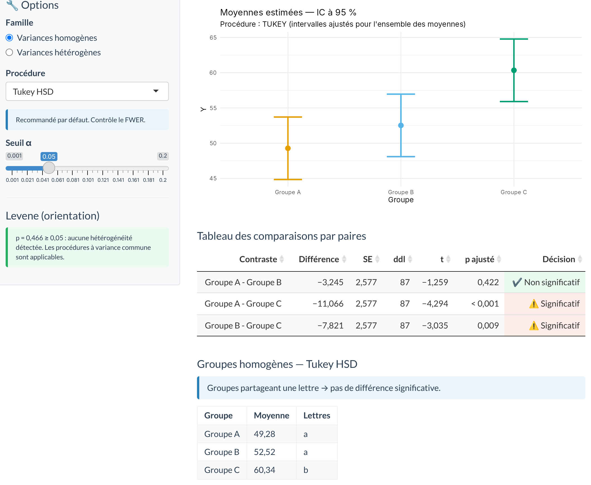
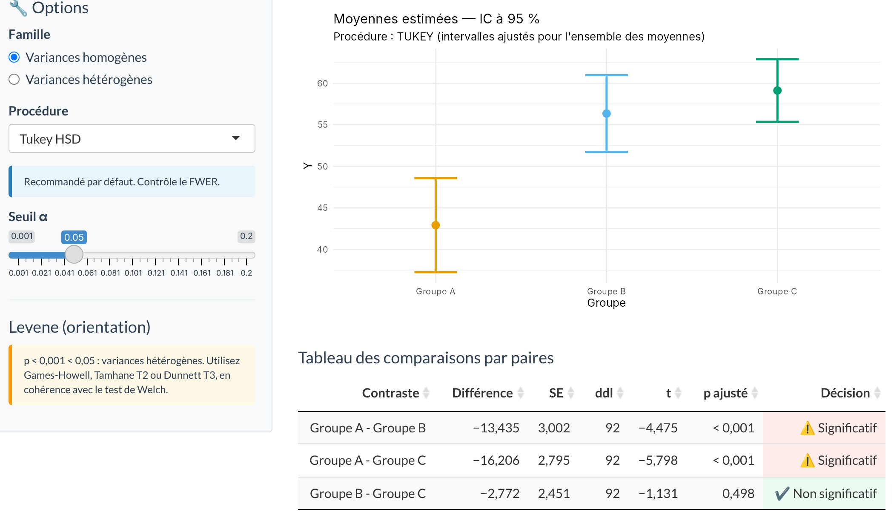
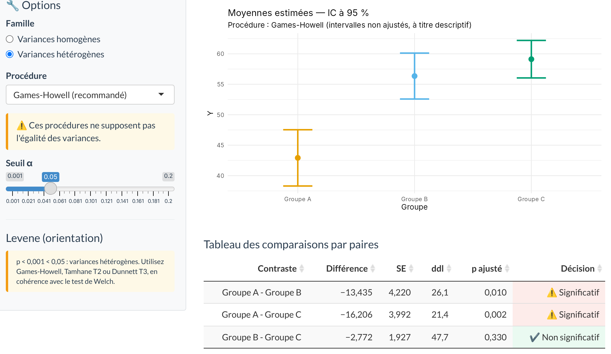

# Après le test global : quelles moyennes diffèrent? {#sec-comparaisons}

```{r}
#| include: false
source("_common.R")
tk <- tukey(fil)
qcrit <- qtukey(0.95, 3, 87)
hsd <- qcrit * sqrt(fil_a$cmr / 30)
se_d <- sqrt(fil_a$cmr * 2 / 30)
brut <- pairwise.t.test(fil$y, fil$groupe, p.adjust.method = "none")$p.value
p_brut <- c(brut[1, 1], brut[2, 1], brut[2, 2])            # A-B, A-C, B-C
p_holm <- p.adjust(p_brut, "holm"); p_bh <- p.adjust(p_brut, "BH"); p_bonf <- p.adjust(p_brut, "bonferroni")
tk_het <- tukey(het); gh_het <- games_howell(het)
d4 <- simuler(ns = rep(30, 4), mu = c(50, 52, 52, 60), sd = rep(10, 4)); a4 <- anova_1f(d4)
tk4 <- tukey(d4)
p4_brut <- pairwise.t.test(d4$y, d4$groupe, p.adjust.method = "none")$p.value
p4_holm <- pairwise.t.test(d4$y, d4$groupe, p.adjust.method = "holm")$p.value
```

::: {.callout-note appearance="simple"}
## Dans ce chapitre

- comprendre pourquoi les comparaisons par paires exigent une correction;
- appliquer la logique de Tukey, de Bonferroni, de Holm et de Benjamini-Hochberg, et refaire Holm à la main;
- choisir Games-Howell quand les variances diffèrent;
- lire intervalles simultanés et lettres de regroupement sans leur faire dire plus qu'ils ne disent.
:::

> **Idée centrale.** Chaque comparaison supplémentaire est une occasion supplémentaire de se tromper. Une procédure de comparaisons multiples fixe à l'avance le risque d'erreur pour **l'ensemble** des comparaisons, puis exige de chacune une preuve d'autant plus forte que la famille est grande.

## La question a posteriori

Un $F$ significatif indique qu'au moins une différence existe, sans identifier les groupes concernés. Les comparaisons a posteriori répondent à cette seconde question tout en protégeant contre l'accumulation d'erreurs de première espèce (@fig-inflation). Elles doivent être choisies selon le contexte et les postulats, non parce qu'elles produisent la plus petite valeur $p$.

Deux taux d'erreur se distinguent :

- le **taux d'erreur par famille** (FWER) : la probabilité de commettre **au moins une** fausse découverte dans la famille de comparaisons. Tukey, Bonferroni, Holm, Hochberg et Scheffé le contrôlent;
- le **taux de fausses découvertes** (FDR) : la proportion **attendue** de fausses découvertes parmi les différences déclarées. Benjamini-Hochberg le contrôle; il est moins exigeant, donc plus puissant, et convient à l'exploration.

## Tukey HSD : la référence pour toutes les paires

La procédure de Tukey compare chaque différence de moyennes à la plus grande différence que le hasard produirait entre $k$ moyennes. Avec des groupes égaux, une paire diffère significativement si

$$|\bar Y_i-\bar Y_j| > \mathrm{HSD}=q_{1-\alpha;\,k,\,N-k}\sqrt{\frac{CM_R}{n}},$$

où $q$ est un quantile de la loi de l'**étendue studentisée** (l'écart entre la plus grande et la plus petite de $k$ moyennes, en unités d'erreur type). Avec des groupes inégaux, l'application utilise la version de Tukey-Kramer, qui remplace $1/n$ par $(1/n_i+1/n_j)/2$.

::: {.case}
Pour le cas fil rouge, $q_{0{,}95;\,3,\,87}=`r frm(qcrit, 3)`$ et
$$\mathrm{HSD}=`r frm(qcrit, 3)`\sqrt{\frac{`r frm(fil_a$cmr)`}{30}}=`r frm(hsd)`.$$
Les différences observées valent `r fr(abs(tk$diff[1]))` (A et B), `r fr(abs(tk$diff[2]))` (A et C) et `r fr(abs(tk$diff[3]))` (B et C). Seule la première est inférieure à `r fr(hsd)` : C diffère de A et de B, mais A et B ne se distinguent pas.
:::

{#fig-cap-tukey .capture}

Le tableau de l'application (@fig-cap-tukey) donne, pour chaque paire, la différence (premier groupe moins second), son erreur type ($\sqrt{2CM_R/n}=`r frm(se_d, 3)`$ pour toutes les paires ici), la statistique $t$ et la valeur $p$ ajustée : `r fr(tk$p[1], 3)` pour A et B, `r if (tk$p[2] < .001) "moins de 0,001" else fr(tk$p[2], 3)` pour A et C, `r fr(tk$p[3], 3)` pour B et C.

## Corriger une famille de valeurs p : Bonferroni, Holm, Benjamini-Hochberg

Une autre approche part des valeurs $p$ **brutes** de tests $t$ (calculés avec $CM_R$) et les ajuste.

- **Bonferroni** multiplie chaque $p$ par le nombre de comparaisons $m$ (ou, ce qui revient au même, teste chacune au seuil $\alpha/m$). Simple et sûr, mais conservateur.
- **Holm** ordonne les $p$ du plus petit au plus grand et multiplie le premier par $m$, le deuxième par $m-1$, etc., en imposant que les $p$ ajustés restent croissants. Il contrôle le FWER comme Bonferroni, mais est toujours au moins aussi puissant. Il n'y a donc aucune raison de préférer Bonferroni à Holm.
- **Benjamini-Hochberg** multiplie le $r$-ième plus petit $p$ par $m/r$ (avec la même contrainte d'ordre). Il contrôle le FDR.

| Paire | $p$ brut | Rang | Holm | | B-H | | Bonferroni |
|:-------|---------:|:----:|:----:|----------:|:-----:|----------:|-------------:|
| A et C | `r fr(p_brut[2], 6)` | 1 | $\times 3$ | `r fr(p_holm[2], 6)` | $\times 3/1$ | `r fr(p_bh[2], 6)` | `r fr(p_bonf[2], 6)` |
| B et C | `r fr(p_brut[3], 5)` | 2 | $\times 2$ | `r fr(p_holm[3], 5)` | $\times 3/2$ | `r fr(p_bh[3], 5)` | `r fr(p_bonf[3], 5)` |
| A et B | `r fr(p_brut[1], 3)` | 3 | $\times 1$ | `r fr(p_holm[1], 3)` | $\times 3/3$ | `r fr(p_bh[1], 3)` | `r fr(min(1, p_bonf[1]), 3)` |

: Holm, Benjamini-Hochberg (B-H) et Bonferroni appliqués au cas fil rouge : multiplicateur, puis valeur $p$ ajustée. {#tbl-holm}

Les trois corrections mènent ici à la même conclusion que Tukey. Elles se distinguent surtout dans les cas limites : la paire B et C passe de `r fr(p_brut[3], 4)` à `r fr(p_bonf[3], 4)` avec Bonferroni, mais seulement à `r fr(p_holm[3], 4)` avec Holm.

## Intervalles simultanés

```{r}
#| label: fig-ic-simultanes
#| fig-cap: "Différences de moyennes du cas fil rouge avec deux intervalles à 95 % : non ajustés (fins, gris) et simultanés de Tukey (épais, bleus). Un intervalle simultané qui exclut 0 correspond à une différence significative pour la procédure de Tukey."
#| fig-height: 2.8
ic <- data.frame(paire = factor(tk$paire, levels = rev(tk$paire)), diff = tk$diff, lo_t = tk$lo, hi_t = tk$hi,
                 lo_b = tk$diff - qt(.975, 87) * se_d, hi_b = tk$diff + qt(.975, 87) * se_d)
ggplot(ic, aes(y = paire)) +
  geom_vline(xintercept = 0, linetype = 2) +
  geom_errorbarh(aes(xmin = lo_t, xmax = hi_t), height = 0.25, linewidth = 1.6, colour = pal$bleu) +
  geom_errorbarh(aes(xmin = lo_b, xmax = hi_b), height = 0.12, linewidth = 0.6, colour = "grey30") +
  geom_point(aes(x = diff), size = 3) +
  scale_x_continuous(labels = axe_fr) +
  labs(x = "Différence de moyennes (premier groupe moins second)", y = NULL)
```

Les intervalles simultanés affichés par l'application sont plus larges que des intervalles isolés, car ils protègent une famille de comparaisons : on peut affirmer avec 95 % de confiance que **les trois** intervalles contiennent simultanément les vraies différences. Une différence dont l'intervalle ajusté exclut zéro est significative pour la procédure choisie. L'intervalle donne aussi le sens et une plage plausible de grandeur, deux informations que la valeur $p$ seule ne donne pas : C dépasse A de `r fr(-tk$hi[2])` à `r fr(-tk$lo[2])` points selon la @fig-ic-simultanes.

## Variances inégales : Games-Howell

Tukey utilise $CM_R$ pour toutes les paires. Si les variances diffèrent, cette erreur type commune est trop petite pour les paires qui impliquent un groupe dispersé et trop grande pour les autres. La procédure de Games-Howell estime, pour chaque paire, sa propre erreur type et ses propres degrés de liberté (à la manière du test $t$ de Welch) :

$$ET_{ij}=\sqrt{\frac{s_i^2}{n_i}+\frac{s_j^2}{n_j}},$$

puis compare la différence au quantile de l'étendue studentisée avec ces degrés de liberté.

{#fig-cap-tukey-hetero .capture}

{#fig-cap-gameshowell .capture}

::: {.case}
Dans le scénario hétérogène, la paire A et B a une erreur type de `r fr(gh_het$se[1], 3)` selon Games-Howell, contre `r fr(sqrt(het_a$cmr * (1/20 + 1/30)), 3)` avec la variance commune : le Groupe A (20 personnes, $s=`r frm(het_a$s[1])`$) est bien plus incertain que ne le suppose Tukey. Les valeurs $p$ changent en conséquence : `r fr(gh_het$p[1], 3)` au lieu de `r if (tk_het$p[1] < .001) "moins de 0,001" else fr(tk_het$p[1], 3)` pour A et B, `r fr(gh_het$p[2], 3)` pour A et C. Les conclusions restent les mêmes ici, mais Tukey surestimait la force de la preuve.
:::

L'application propose aussi Tamhane T2 et Dunnett T3, deux procédures fondées sur la même idée, un peu plus conservatrices. La règle de cohérence est simple : **Welch pour le test global, Games-Howell (ou T2, T3) pour les paires**; **$F$ classique, Tukey (ou Holm)**.

## Les autres procédures de l'application

| Situation | Procédure | Idée principale |
|:--|:--|:--|
| Toutes les paires, variances homogènes | **Tukey HSD** | Référence naturelle; contrôle exact du FWER |
| Petit nombre de comparaisons ciblées | **Holm** (ou Bonferroni, Hochberg) | Contrôle du FWER; Holm domine Bonferroni |
| Exploration, tolérance à davantage de découvertes | **Benjamini-Hochberg** | Contrôle du FDR |
| Toute combinaison de moyennes, même non planifiée | **Scheffé** | Très conservateur pour les seules paires |
| Variances inégales | **Games-Howell**, Tamhane T2, Dunnett T3 | Une erreur type par paire |
| Comparaisons sans correction | LSD de Fisher | À réserver à $k=3$ après un $F$ significatif; sinon, risque accru |
| Méthodes historiques par étapes | Duncan, SNK | Contrôle imparfait du FWER; à éviter |

: Les procédures offertes et leur usage. {#tbl-procedures}

Les méthodes de regroupement par **lettres** résument les paires : deux groupes qui partagent une lettre ne diffèrent pas significativement. Dans le cas fil rouge, A et B portent « a », C porte « b ». Ce résumé est commode, mais il dépend de la procédure, il peut produire des chevauchements déroutants (A = « a », B = « ab », C = « b ») et il masque l'ampleur des écarts. Il ne remplace pas le tableau complet.

## Dans l'application

::: {.app-step}
Dans **Analyse ▸ Comparaisons ▸ A posteriori**, laissez **Famille : Variances homogènes** et **Procédure : Tukey HSD**. Repérez la paire non significative, puis passez à **Holm (Bonferroni séq.)**, à **Benjamini-Hochberg (FDR)** et à **LSD Fisher (non corrigé)**. Notez comment varie la valeur $p$ de la paire B et C.
:::

::: {.app-step}
Créez le scénario hétérogène (tailles **20; 30; 45**, écarts-types 18, 10, 6). L'encadré **Levene (orientation)** recommande alors la famille hétérogène. Choisissez **Variances hétérogènes ▸ Games-Howell (recommandé)** et comparez les erreurs types avec celles de Tukey.
:::

## Laboratoire

::: {.app-step}
Réglez $k=4$ groupes de 30, moyennes 50, 52, 52 et 60, écarts-types 10, graine 2026. Faites le test global, puis comparez Tukey, Holm et LSD pour la paire C et D.
:::

::: {.callout-tip collapse="true"}
## Réponse

Le test global est significatif, $F(3, 116)=`r frm(a4$F)`$, $`r pvm(a4$p)`$. Les moyennes observées valent `r paste(fr(a4$m), collapse = ", ")`. Avec Tukey, D diffère de A ($p=`r frm(tk4$p[3], 3)`$) et de B ($p=`r frm(tk4$p[5], 3)`$), mais pas de C ($p=`r frm(tk4$p[6], 3)`$). Holm donne la même conclusion ($p=`r frm(p4_holm[3, 3], 3)`$ pour C et D). Le LSD non corrigé, lui, déclare C et D différents ($p=`r frm(p4_brut[3, 3], 3)`$) : avec six comparaisons, ce gain apparent de sensibilité se paie par un risque d'erreur familial qui dépasse largement 5 %. Les quatre moyennes de population (50, 52, 52, 60) impliquent pourtant une vraie différence entre C et D : la procédure corrigée la manque ici, faute de puissance. Le chapitre [-@sec-contrastes] montre comment une hypothèse formulée d'avance évite de disperser la puissance sur six paires.
:::

## À retenir

- Après un $F$ significatif, une procédure corrigée identifie les paires qui diffèrent en contrôlant le FWER (ou le FDR).
- Tukey HSD est la référence pour toutes les paires lorsque les variances sont homogènes.
- Holm contrôle le FWER comme Bonferroni, en étant toujours au moins aussi puissant.
- Avec des variances inégales, Games-Howell estime une erreur type par paire; il accompagne naturellement Welch.
- Les intervalles simultanés donnent le sens et l'ampleur des différences; les lettres ne sont qu'un résumé.

## Quiz

1. Avec $k=5$, combien de paires une procédure de Tukey compare-t-elle?
2. Trois valeurs $p$ brutes : 0,004, 0,020 et 0,030. Calculez les $p$ ajustés de Holm.
3. Pourquoi le LSD de Fisher est-il plus « puissant » que Tukey? À quel prix?
4. Le test de Welch a été retenu. Pourquoi Tukey n'est-il pas cohérent avec ce choix?
5. Deux groupes partagent la lettre « b ». Que peut-on conclure?

::: {.callout-tip collapse="true"}
## Réponses du quiz

1. $\binom52=10$ paires.
2. $0{,}004\times3=0{,}012$; $0{,}020\times2=0{,}040$; $0{,}030\times1=0{,}030$, porté à 0,040 pour respecter l'ordre. Résultat : 0,012, 0,040, 0,040.
3. Il n'ajuste rien : chaque paire est testée au seuil $\alpha$. Le prix est un taux d'erreur par famille bien supérieur à $\alpha$ dès que les comparaisons se multiplient.
4. Tukey repose sur une variance commune, précisément le postulat que le choix de Welch a écarté.
5. Seulement que leur différence n'est pas significative pour la procédure utilisée; pas qu'ils sont égaux.
:::
