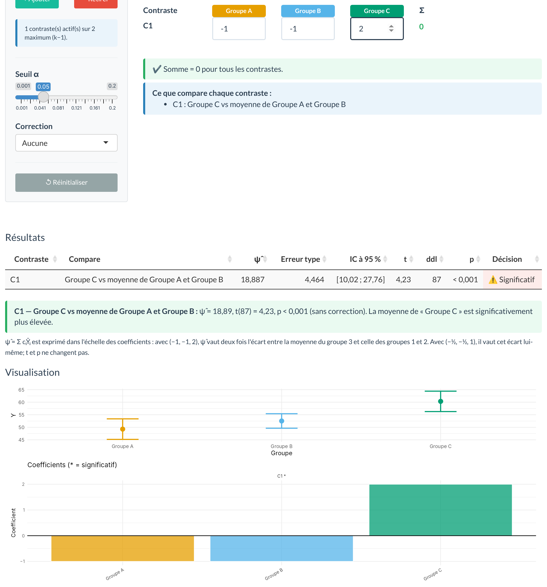
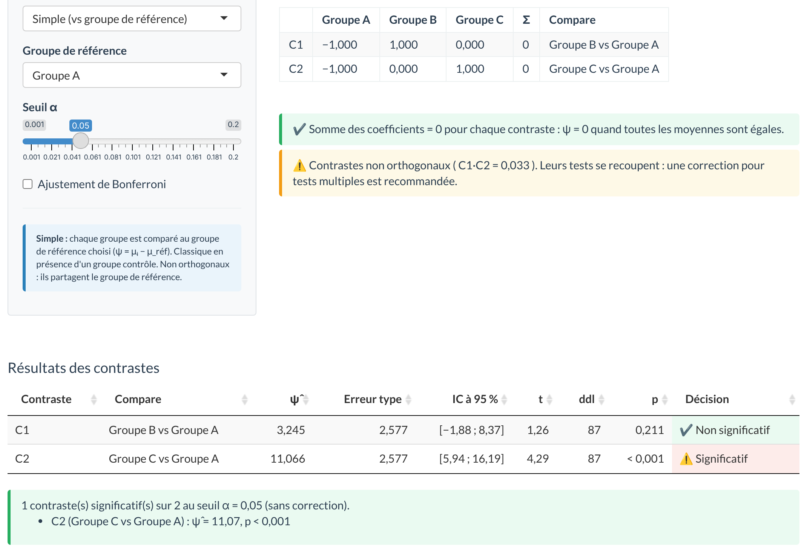
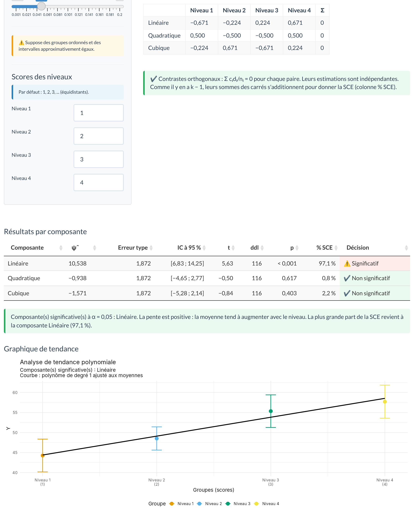

# Contrastes planifiés et tendances {#sec-contrastes}

```{r}
#| include: false
source("_common.R")
c1 <- contraste(fil, c(-1, -1, 2)); c1b <- contraste(fil, c(-0.5, -0.5, 1)); c2 <- contraste(fil, c(1, -1, 0))
cs_b <- contraste(fil, c(-1, 1, 0)); cs_c <- contraste(fil, c(-1, 0, 1))
P <- contr.poly(4)
tend <- lapply(1:3, function(j) contraste(ord, P[, j]))
u <- simuler(ns = rep(30, 4), mu = c(60, 50, 50, 60), sd = rep(10, 4)); u_a <- anova_1f(u)
tend_u <- lapply(1:3, function(j) contraste(u, P[, j]))
```

::: {.callout-note appearance="simple"}
## Dans ce chapitre

- traduire une hypothèse de recherche en coefficients de contraste;
- tester un contraste et l'interpréter dans les unités de Y;
- vérifier l'orthogonalité de deux contrastes et décomposer SCE;
- lire les codages standards de l'application;
- analyser une tendance lorsque les niveaux du facteur sont ordonnés.
:::

> **Idée centrale.** Un contraste pose à l'avance **une** question précise aux données, au lieu de leur poser toutes les questions possibles après coup. Moins de questions, mieux choisies : plus de puissance et une interprétation directe.

## Tester une hypothèse structurée

Un contraste est une combinaison pondérée des moyennes dont les coefficients totalisent zéro :

$$\hat\psi=\sum_{i=1}^{k}c_i\bar Y_i,\qquad \sum_i c_i=0.$$

Les coefficients $c_i$ expriment une question précise. Avec trois groupes, $(-1,-1,2)$ compare le troisième groupe à la moyenne des deux premiers; $(1,-1,0)$ compare les deux premiers entre eux. Ce n'est pas « une autre façon de faire des paires » : c'est une hypothèse synthétique qui peut être plus proche de la théorie. La contrainte $\sum c_i=0$ garantit que le contraste vaut zéro quand toutes les moyennes sont égales.

Le contraste se teste avec la variance commune $CM_R$ :

$$ET(\hat\psi)=\sqrt{CM_R\sum_i\frac{c_i^2}{n_i}},\qquad t=\frac{\hat\psi}{ET(\hat\psi)}\ \text{avec}\ N-k\ \text{ddl}.$$

Il possède aussi sa propre somme de carrés, à un degré de liberté :

$$SC_\psi=\frac{\hat\psi^2}{\sum_i c_i^2/n_i}.$$

::: {.case}
Les deux premiers dispositifs (ressources en ligne, tutorat) sont des formules ordinaires; le troisième ajoute une rétroaction personnalisée. L'hypothèse de l'équipe, formulée avant la collecte, est que **la rétroaction améliore la réussite par rapport aux formules ordinaires**. Le contraste $(-1,-1,2)$ la traduit :
$$\hat\psi=-49{,}28-52{,}52+2\times60{,}34=`r frm(c1$psi)`,\qquad ET=\sqrt{`r frm(fil_a$cmr)`\times\frac{1+1+4}{30}}=`r frm(c1$se, 3)`,$$
d'où $t(87)=`r frm(c1$t)`$, $`r pvm(c1$p)`$, IC à 95 % [`r fr(c1$lo)` ; `r fr(c1$hi)`].
:::

Comment lire $\hat\psi=`r fr(c1$psi)`$? Avec les coefficients $(-1,-1,2)$, $\hat\psi$ vaut **deux fois** l'écart entre la moyenne de C et la moyenne de A et B. Avec $(-\tfrac12,-\tfrac12,1)$, on obtiendrait $\hat\psi=`r frm(c1b$psi)`$ : la rétroaction est associée à un score supérieur d'environ `r fr(c1b$psi, 1)` points à la moyenne des deux autres dispositifs. La statistique $t$ et la valeur $p$ ne dépendent pas de cette échelle; pour interpréter $\hat\psi$ dans les unités de Y, on choisit des coefficients dont les positifs totalisent 1 et les négatifs $-1$.

{#fig-cap-planifie .capture}

## Orthogonalité : décomposer SCE

Deux contrastes $c$ et $d$ sont **orthogonaux** si

$$\sum_i\frac{c_id_i}{n_i}=0$$

(avec des groupes égaux, simplement $\sum c_id_i=0$). Deux contrastes orthogonaux posent des questions qui ne se recouvrent pas. Un ensemble de $k-1$ contrastes orthogonaux **décompose exactement** SCE.

::: {.case}
Les contrastes $(-1,-1,2)$ et $(1,-1,0)$ sont orthogonaux : $(-1)(1)+(-1)(-1)+(2)(0)=0$. Leurs sommes de carrés valent `r fr(c1$sc)` et `r fr(c2$sc)`, et leur somme redonne SCE : `r fr(c1$sc)` + `r fr(c2$sc)` = `r fr(c1$sc + c2$sc)`. Autrement dit, `r pc(c1$sc / fil_a$sce)` de la variabilité entre dispositifs tient à l'opposition « rétroaction contre formules ordinaires », et seulement `r pc(c2$sc / fil_a$sce)` à la différence entre les deux formules ordinaires.
:::

L'orthogonalité n'est pas une obligation : des contrastes non orthogonaux sont légitimes s'ils répondent aux questions posées. Leurs tests se recouvrent alors en partie, et l'application suggère une correction (Bonferroni ou Holm) quand plusieurs contrastes sont testés ensemble.

## Planifié ou non?

Les contrastes formulés **avant** de consulter les données sont dits planifiés. Un petit nombre de contrastes planifiés (au plus $k-1$) peut être testé sans correction, ou avec une correction légère de Holm. Un contraste choisi **après** avoir vu les moyennes (« C semble plus haut que les autres, testons C contre A et B ») n'a pas le même statut : on a, en pratique, exploré toutes les combinaisons possibles. Il faut alors une procédure qui protège contre toutes les combinaisons, celle de Scheffé, qui remplace la valeur critique $t$ par $\sqrt{(k-1)F_{1-\alpha;\,k-1,\,N-k}}$ (`r fr(sqrt(2 * qf(.95, 2, 87)), 2)` au lieu de `r fr(qt(.975, 87), 2)` ici).

## Codages standards

L'application propose, dans **Contrastes standards**, cinq systèmes de $k-1$ contrastes, qui correspondent aux façons usuelles de coder un facteur en régression.

| Codage | Ce que compare chaque contraste | Orthogonal? |
|:--|:--|:-:|
| Déviation | chaque groupe (sauf le dernier) contre la grande moyenne | non |
| Simple | chaque groupe contre un groupe de référence | non |
| Différence (Helmert inverse) | chaque groupe contre la moyenne des groupes précédents | oui* |
| Helmert | chaque groupe contre la moyenne des groupes suivants | oui* |
| Groupes adjacents | chaque groupe contre le suivant | non |

: Les codages standards. \*Avec des groupes de même taille. {#tbl-codages}

{#fig-cap-simple .capture}

Le codage simple (@fig-cap-simple) est celui de la régression sur indicatrices du chapitre [-@sec-reperes] : chaque coefficient est l'écart à la référence. Ici, B dépasse A de `r fr(cs_b$psi)` points ($`r pvm(cs_b$p)`$) et C dépasse A de `r fr(cs_c$psi)` points ($`r pvm(cs_c$p)`$). Ces codages sont utiles pour comprendre ce qu'implique le codage d'un facteur, mais ils ne dispensent pas de formuler la question substantive. Avant d'interpréter un coefficient, dites en mots quelles moyennes il oppose; la colonne **Compare** de l'application le fait pour vous.

## Tendance polynomiale {#sec-tendance}

Lorsque les niveaux sont ordonnés et approximativement équidistants (dose, temps, niveau de traitement), une tendance polynomiale teste des composantes linéaire, quadratique, cubique, etc. Chaque composante est un contraste dont les coefficients suivent un polynôme orthogonal.

```{r}
#| label: fig-polynomes
#| fig-cap: "Coefficients des contrastes polynomiaux orthogonaux pour k = 4 niveaux équidistants. Le contraste linéaire oppose les extrêmes en croissant régulièrement; le quadratique oppose les extrêmes au centre (forme en U); le cubique alterne deux fois de signe (forme en S)."
#| fig-height: 2.8
pp <- data.frame(niveau = rep(1:4, 3), coef = c(P),
                 comp = factor(rep(c("Linéaire", "Quadratique", "Cubique"), each = 4),
                               levels = c("Linéaire", "Quadratique", "Cubique")))
ggplot(pp, aes(niveau, coef)) +
  geom_hline(yintercept = 0, colour = "grey50") +
  geom_col(fill = pal$sarcelle, width = 0.6) +
  geom_line(colour = pal$or, linewidth = 1) + geom_point(colour = pal$or, size = 2) +
  facet_wrap(~comp) +
  scale_x_continuous(breaks = 1:4, labels = paste("Niv.", 1:4)) +
  scale_y_continuous(labels = axe_fr) +
  labs(x = NULL, y = "Coefficient")
```

Une composante linéaire suggère une hausse ou une baisse régulière; une composante quadratique peut suggérer un sommet, un creux ou un effet de saturation; une composante cubique, un profil plus irrégulier. Avec $k$ niveaux, il y a $k-1$ composantes, orthogonales entre elles : elles décomposent exactement SCE, et la colonne **% SCE** de l'application indique la part de chacune.

{#fig-cap-tendance .capture}

::: {.case}
Dans le scénario ordonné (@fig-cap-tendance), la composante linéaire domine : $\hat\psi=`r frm(tend[[1]]$psi)`$, $t(116)=`r frm(tend[[1]]$t)`$, $`r pvm(tend[[1]]$p)`$, `r pc(tend[[1]]$sc / ord_a$sce)` de SCE. Les composantes quadratique ($`r pvm(tend[[2]]$p)`$) et cubique ($`r pvm(tend[[3]]$p)`$) ne sont pas significatives. Les moyennes augmentent régulièrement avec le niveau; un modèle linéaire résume presque toute la variabilité entre les niveaux.
:::

Des étiquettes ordinales sans distance interprétable ne justifient pas automatiquement cette analyse : « faible, moyen, élevé » n'implique pas que l'écart entre « faible » et « moyen » soit égal à celui entre « moyen » et « élevé ».

::: {.callout-warning}
## Attention aux scores des niveaux

La tendance polynomiale dépend des valeurs attribuées aux niveaux. Des doses 0, 5 et 50 ne sont pas équidistantes; utiliser les scores 1, 2, 3 imposerait une géométrie erronée. L'application permet d'inscrire les scores réels dans **Scores des niveaux**; elle recalcule alors les coefficients orthogonaux pour ces scores.
:::

## Dans l'application

::: {.app-step}
Dans **Analyse ▸ Comparaisons ▸ Contrastes planifiés**, entrez $(-1,-1,2)$ pour C1. Vérifiez la somme (colonne Σ), lisez la description « Groupe C vs moyenne de Groupe A et Groupe B », puis le résultat. Ajoutez un contraste C2 = $(1,-1,0)$ avec **+ Ajouter** : l'application confirme l'orthogonalité et la colonne **% SCE** totalise 100 %.
:::

::: {.app-step}
Pour la tendance, cochez **Type de VI ▸ Quantitative / ordinale**, réglez $k=4$, les moyennes 45, 50, 55, 60 et les écarts-types 10. Ouvrez **Tendance polynomiale**. Modifiez ensuite les **Scores des niveaux** (par exemple 0, 1, 2, 10) et observez que la décomposition change alors que les données sont les mêmes.
:::

## Laboratoire

::: {.app-step}
Toujours avec 4 niveaux et la VI quantitative, créez un profil en U : moyennes 60, 50, 50, 60. Avant de regarder, prédisez quelle composante dominera et ce que vaudra la composante linéaire.
:::

::: {.callout-tip collapse="true"}
## Réponse

La composante **quadratique** domine : $\hat\psi=`r frm(tend_u[[2]]$psi)`$, $t(116)=`r frm(tend_u[[2]]$t)`$, $`r pvm(tend_u[[2]]$p)`$, soit `r pc(tend_u[[2]]$sc / u_a$sce)` de SCE. La composante linéaire est presque nulle ($`r pvm(tend_u[[1]]$p)`$) : le profil monte autant qu'il descend. Remarque importante : une analyse limitée à la tendance linéaire conclurait à tort à l'absence d'effet du niveau, alors que le test global est nettement significatif, $F(3, 116)=`r frm(u_a$F)`$.
:::

## À retenir

- Un contraste traduit une hypothèse en coefficients de somme nulle; il se teste par $t$ avec $N-k$ ddl.
- L'échelle des coefficients change $\hat\psi$, pas $t$ ni $p$; des positifs totalisant 1 donnent $\hat\psi$ dans les unités de Y.
- $k-1$ contrastes orthogonaux décomposent exactement SCE.
- Planifiés : peu nombreux, formulés d'avance. Choisis après coup : Scheffé.
- La tendance polynomiale exige des niveaux ordonnés avec des scores interprétables.

## Quiz

1. Avec quatre groupes, écrivez un contraste qui oppose la moyenne de A et B à celle de C et D.
2. Les contrastes $(1,-1,0)$ et $(1,0,-1)$ sont-ils orthogonaux (groupes égaux)?
3. Un contraste a $\hat\psi=6$ avec les coefficients $(-1,-1,2)$. Que vaudrait $\hat\psi$ avec $(-\tfrac12,-\tfrac12,1)$? Et $t$?
4. Combien de composantes polynomiales y a-t-il avec 5 niveaux?
5. Après avoir vu les moyennes, une étudiante teste « D contre la moyenne des trois autres ». Quelle procédure convient?

::: {.callout-tip collapse="true"}
## Réponses du quiz

1. $(1,1,-1,-1)$, ou $(\tfrac12,\tfrac12,-\tfrac12,-\tfrac12)$ pour une lecture dans les unités de Y.
2. Non : $1\times1+(-1)\times0+0\times(-1)=1\neq0$. Ils partagent le Groupe A.
3. $\hat\psi=3$; $t$ ne change pas.
4. Quatre : linéaire, quadratique, cubique et d'ordre 4.
5. Scheffé : le contraste a été suggéré par les données.
:::
