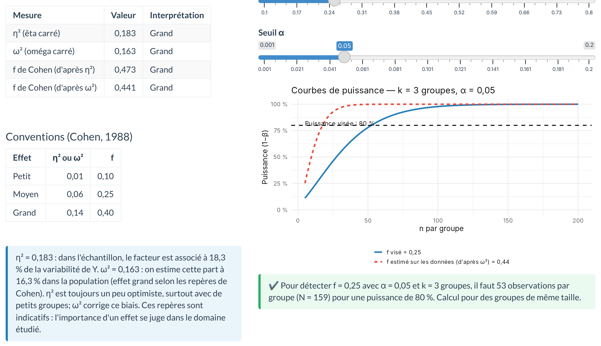

# Importance pratique et puissance {#sec-effet}

```{r}
#| include: false
source("_common.R")
f_eta <- sqrt(fil_a$eta2 / (1 - fil_a$eta2)); f_om <- sqrt(fil_a$omega2 / (1 - fil_a$omega2))
# Biais de η² et ω² : 4 000 échantillons sous H0 et sous le cas fil rouge
sim_eff <- function(mu, R = 4000, n = 30, s = 10, graine = 31) {
  set.seed(graine); k <- length(mu); N <- n * k
  t(replicate(R, {
    y <- matrix(rnorm(N, rep(mu, each = n), s), n)
    m <- colMeans(y); g <- mean(y)
    sce <- n * sum((m - g)^2); scr <- sum((n - 1) * apply(y, 2, var)); cmr <- scr / (N - k)
    c(eta2 = sce / (sce + scr), omega2 = max(0, (sce - (k - 1) * cmr) / (sce + scr + cmr)))
  }))
}
e0 <- sim_eff(c(50, 50, 50)); e1 <- sim_eff(mu_fil, graine = 32)
n25 <- n_requis(0.25, 3); n_fil <- n_requis(f_fil_th, 3)
n25_k5 <- n_requis(0.25, 5); n25_a01 <- n_requis(0.25, 3, a = 0.01); n10 <- n_requis(0.10, 3)
```

::: {.callout-note appearance="simple"}
## Dans ce chapitre

- distinguer significativité statistique et importance pratique;
- calculer et interpréter $\eta^2$, $\omega^2$ et le $f$ de Cohen;
- comprendre pourquoi $\eta^2$ surestime l'effet et comment $\omega^2$ corrige ce biais;
- relier puissance, taille d'effet, effectif et seuil, et planifier une taille d'échantillon.
:::

> **Idée centrale.** La valeur $p$ répond à « y a-t-il un effet? »; la taille d'effet répond à « de quelle ampleur? ». La puissance relie les deux avant la collecte : quelle taille d'échantillon faut-il pour détecter, avec une bonne probabilité, le plus petit effet qui compte?

## Au-delà de « significatif »

La significativité dépend à la fois de l'écart entre les moyennes, de la dispersion et de l'effectif. Avec un très grand échantillon, un effet minuscule peut devenir significatif. Avec un petit échantillon, un effet potentiellement important peut rester incertain. Une analyse doit donc rapporter une mesure d'ampleur.

$$\eta^2=\frac{\mathrm{SCE}}{\mathrm{SCT}},\qquad
\omega^2=\frac{\mathrm{SCE}-(k-1)CM_R}{\mathrm{SCT}+CM_R}.$$

$\eta^2$ est la proportion de variabilité de Y associée au facteur **dans l'échantillon**; c'est le $R^2$ de la régression sur indicatrices. $\omega^2$ corrige une partie de son biais optimiste et est préférable pour estimer l'effet **en population**. Si $\mathrm{SCE}<(k-1)CM_R$, ce qui arrive souvent sous $H_0$, $\omega^2$ serait négatif : on le rapporte alors comme 0.

Le $f$ de Cohen exprime la même information sur une autre échelle, celle de l'écart-type des moyennes en unités d'écart-type intra-groupe (chapitre [-@sec-concevoir]) :

$$f=\frac{\sigma_{\text{inter}}}{\sigma_{\text{intra}}}=\sqrt{\frac{\eta^2}{1-\eta^2}}.$$

::: {.case}
Pour le cas fil rouge, $\eta^2=`r frm(fil_a$sce, 2)`/`r frm(fil_a$sct, 2)`=`r frm(fil_a$eta2, 3)`$ et
$$\omega^2=\frac{`r frm(fil_a$sce)`-2\times`r frm(fil_a$cmr)`}{`r frm(fil_a$sct)`+`r frm(fil_a$cmr)`}=`r frm(fil_a$omega2, 3)`.$$
D'où $f=`r frm(f_eta, 3)`$ (d'après $\eta^2$) ou $f=`r frm(f_om, 3)`$ (d'après $\omega^2$). Les valeurs de population sont $\eta^2=`r frm(eta2_fil_th, 3)`$ et $f=`r frm(f_fil_th, 3)`$ : $\omega^2$ en est plus proche que $\eta^2$.
:::

{#fig-cap-effet .capture}

## Le biais de η²

Pourquoi $\eta^2$ surestime-t-il l'effet? Parce que les moyennes observées contiennent de l'erreur d'échantillonnage : même si les moyennes de population sont égales, les moyennes observées ne le sont jamais exactement, et SCE est toujours positif. Une simulation le montre.

```{r}
#| label: fig-biais
#| fig-cap: "Distribution de η² et de ω² sur 4 000 échantillons (3 groupes de 30, σ = 10). Traits pointillés : valeur de population (0 sous $H_0$; 0,144 dans le cas fil rouge). η² est systématiquement décalé vers le haut; ω² est presque sans biais, au prix de nombreuses valeurs ramenées à 0 sous $H_0$."
#| fig-height: 4.4
dd <- rbind(data.frame(scen = "Sous H0 : μ = 50, 50, 50", indice = rep(c("η²", "ω²"), each = nrow(e0)), v = c(e0)),
            data.frame(scen = "Cas fil rouge : μ = 50, 54, 60", indice = rep(c("η²", "ω²"), each = nrow(e1)), v = c(e1)))
dd$scen <- factor(dd$scen, levels = unique(dd$scen))
vr <- data.frame(scen = factor(levels(dd$scen), levels = levels(dd$scen)), v = c(0, eta2_fil_th))
ggplot(dd, aes(v, fill = indice)) +
  geom_histogram(binwidth = 0.01, boundary = 0, position = "identity", alpha = 0.55) +
  geom_vline(data = vr, aes(xintercept = v), linetype = 2) +
  facet_wrap(~scen, ncol = 1, scales = "free_y") +
  scale_fill_manual(values = c(pal$bleu, pal$or), name = NULL) +
  scale_x_continuous(labels = axe_fr, limits = c(-0.005, 0.4)) + scale_y_continuous(labels = axe_fr) +
  labs(x = "Valeur de l'indice", y = "Nombre d'échantillons")
```

Sous $H_0$, la moyenne des $\eta^2$ simulés vaut `r fr(mean(e0[, 1]), 3)`, très près de sa valeur attendue $(k-1)/(N-1)=2/89=0{,}022$, alors que l'effet réel est nul. Dans le cas fil rouge, elle vaut `r fr(mean(e1[, 1]), 3)` pour une valeur de population de `r fr(eta2_fil_th, 3)`; celle des $\omega^2$ vaut `r fr(mean(e1[, 2]), 3)`. Le biais de $\eta^2$ diminue quand $N$ augmente, mais il est sensible avec de petits échantillons et de nombreux groupes.

## Interpréter une taille d'effet

| Effet | $\eta^2$ ou $\omega^2$ | $f$ |
|:--|--:|--:|
| Petit | 0,01 | 0,10 |
| Moyen | 0,06 | 0,25 |
| Grand | 0,14 | 0,40 |

: Conventions de Cohen (1988). {#tbl-cohen}

Ces repères ne sont que des repères. Aucune convention (« petit », « moyen », « grand ») ne remplace l'interprétation dans les unités et le domaine étudiés. Un écart moyen de 11 points sur 100 entre deux dispositifs de soutien peut représenter la différence entre l'échec et la réussite d'un cours; l'interprétation substantielle passe par les **différences de moyennes** et leurs intervalles (chapitres [-@sec-comparaisons] et [-@sec-contrastes]), pas seulement par un indice global.

## La puissance est une propriété du plan

La puissance est la probabilité de rejeter $H_0$ lorsqu'un effet d'une taille donnée existe. Elle correspond à l'aire de la loi $F$ décentrée au-delà de la valeur critique (@fig-f-h0-h1). Elle augmente avec :

- la **taille d'effet** $f$ : un plus grand écart entre les moyennes, ou un bruit plus faible;
- l'**effectif** : $\lambda=Nf^2$ croît avec $N$;
- le **seuil** $\alpha$ : un seuil plus permissif élargit la région de rejet;
- un **plan équilibré** (@tbl-alloc).

```{r}
#| label: fig-puissance
#| fig-cap: "Puissance du test F (k = 3, α = 0,05) selon la taille de chaque groupe, pour trois tailles d'effet. Ligne pointillée : le seuil conventionnel de 0,80. Le point marque le cas fil rouge (f = 0,41, n = 30)."
#| fig-height: 3.6
ns <- 2:200
pw <- do.call(rbind, lapply(c(0.10, 0.25, 0.40), function(f)
  data.frame(n = ns, p = puissance(ns, f, 3), f = paste0("f = ", fr(f, 2)))))
ggplot(pw, aes(n, p, colour = f)) +
  geom_hline(yintercept = 0.8, linetype = 2, colour = "grey40") +
  geom_line(linewidth = 1) +
  annotate("point", x = 30, y = puissance(30, f_fil_th, 3), size = 3) +
  scale_colour_manual(values = c(pal$rouge, pal$bleu, pal$vert), name = NULL) +
  scale_y_continuous(labels = axe_fr, limits = c(0, 1)) + scale_x_continuous(labels = axe_fr) +
  labs(x = "n par groupe", y = "Puissance")
```

La @fig-puissance traduit ces relations en tailles d'échantillon. Pour détecter un effet moyen ($f=0{,}25$) avec une puissance de 0,80, il faut `r n25` personnes par groupe (`r 3 * n25` au total); pour un petit effet ($f=0{,}10$), il en faut `r n10` par groupe. Le cas fil rouge, avec un effet de population de `r fr(f_fil_th, 2)` et 30 personnes par groupe, a une puissance de `r fr(puissance(30, f_fil_th, 3), 2)`; `r n_fil` personnes par groupe auraient suffi pour atteindre 0,80.

La puissance doit idéalement être considérée **avant** la collecte : quel plus petit effet substantiellement utile veut-on être capable de détecter? Après une étude, il est généralement plus informatif de présenter l'estimation de l'effet et son incertitude que de calculer une « puissance observée » à partir de l'effet estimé : celle-ci n'est qu'une transformation de la valeur $p$ et n'apporte aucune information nouvelle.

## Dans l'application

::: {.app-step}
Dans **Analyse ▸ Taille d'effet & Puissance**, lisez les quatre indices du cas fil rouge et leur interprétation. Le curseur **f de Cohen cible** fixe l'effet à détecter; la courbe pleine montre la puissance selon $n$ pour cet effet, la courbe pointillée celle de l'effet estimé sur les données. L'encadré vert donne la taille par groupe nécessaire pour une puissance de 0,80.
:::

::: {.app-step}
Revenez ensuite aux paramètres de simulation et comparez deux façons d'augmenter la probabilité de détection : augmenter $n$, ou augmenter l'écart entre les moyennes. Elles ne répondent pas à la même question : la première est une décision de plan, la seconde une hypothèse sur le phénomène.
:::

## Laboratoire

::: {.app-step}
Avec **f de Cohen cible** = 0,25, notez la taille recommandée par groupe pour $k=3$ et $\alpha=0{,}05$. Faites ensuite varier une seule chose à la fois : $k=5$ groupes, puis $\alpha=0{,}01$. Prédisez le sens de chaque changement avant de regarder.
:::

::: {.callout-tip collapse="true"}
## Réponse

Avec $k=3$ et $\alpha=0{,}05$ : `r n25` par groupe. Avec $k=5$ : `r n25_k5` par groupe, moins par groupe mais `r 5 * n25_k5` au total au lieu de `r 3 * n25`; le test global répartit l'effet sur plus de degrés de liberté. Avec $\alpha=0{,}01$ (et $k=3$) : `r n25_a01` par groupe; un seuil plus exigeant se paie en effectif. Dans tous les cas, la taille d'effet pèse le plus lourd : passer de $f=0{,}25$ à $f=0{,}10$ multiplie l'effectif nécessaire par environ six.
:::

## À retenir

- Rapportez toujours une taille d'effet; préférez $\omega^2$ à $\eta^2$ pour estimer l'effet en population.
- $\eta^2$ est biaisé vers le haut, d'autant plus que $N$ est petit et $k$ grand.
- $f=\sigma_{\text{inter}}/\sigma_{\text{intra}}$ est l'indice des calculs de puissance.
- La puissance dépend de $f$, de $N$, de $\alpha$ et de l'équilibre du plan; elle se calcule avant la collecte.
- La « puissance observée » calculée après coup n'ajoute rien à la valeur $p$.

## Quiz

1. SCE = 120, SCT = 600, $k=4$, $CM_R=5$. Calculez $\eta^2$ et $\omega^2$.
2. Un $\eta^2$ de 0,06 correspond à quel $f$?
3. Une étude de 3 000 personnes trouve $p<0{,}001$ et $\omega^2=0{,}004$. Que conclure?
4. Pourquoi $\omega^2$ est-il souvent nul sous $H_0$?
5. Quel facteur augmente la puissance sans changer le phénomène étudié?

::: {.callout-tip collapse="true"}
## Réponses du quiz

1. $\eta^2=120/600=0{,}20$; $\omega^2=(120-3\times5)/(600+5)=0{,}174$.
2. $f=\sqrt{0{,}06/0{,}94}=0{,}25$.
3. L'effet est très probablement réel, mais minuscule : le facteur explique moins de 0,5 % de la variabilité. Son importance pratique est à discuter dans les unités de Y.
4. Sous $H_0$, SCE fluctue autour de $(k-1)\sigma^2$; il est souvent inférieur à $(k-1)CM_R$, et la valeur négative est ramenée à 0.
5. L'effectif (ou un plan mieux équilibré, ou une mesure plus fiable qui réduit $\sigma$).
:::
