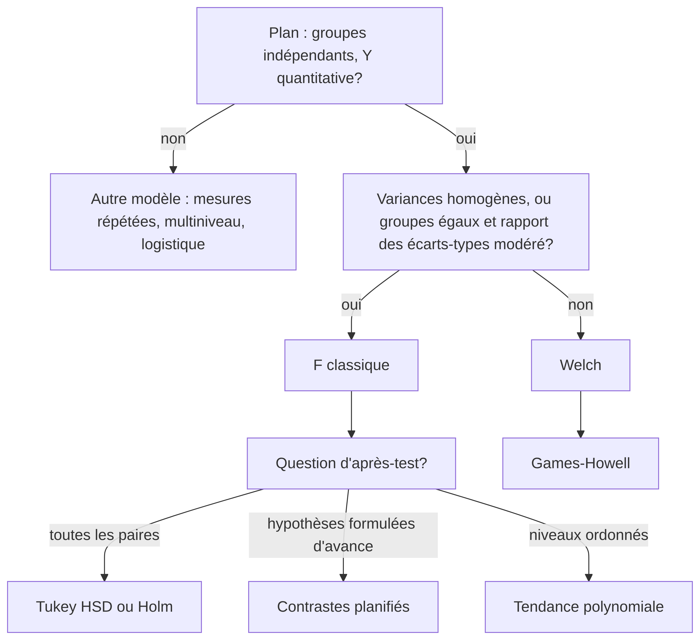

# Décider et rapporter une ANOVA {#sec-rapporter}

```{r}
#| include: false
source("_common.R")
tk <- tukey(fil); w_het <- welch(het); gh <- games_howell(het); lev_het <- levene_med(het)
c_half <- contraste(fil, c(-0.5, -0.5, 1)); lev_fil <- levene_med(fil)
pp <- function(p) if (p < 0.001) "< 0{,}001" else paste0("= ", frm(p, 3))
```

## Une fiche de décision

Cette fiche ne remplace pas le jugement méthodologique; elle aide à maintenir une chaîne de décisions cohérente entre le plan, les diagnostics et les résultats.

| Étape | Question | Dans l'application | Suite raisonnable |
|:--|:--|:--|:--|
| 1. Plan | Une personne appartient-elle à un seul groupe? Y est-elle quantitative? | **Introduction**, **Données simulées** | Sinon, l'ANOVA indépendante à un facteur n'est probablement pas le bon modèle |
| 2. Description | Centres, dispersions et tailles racontent-ils une histoire lisible? | **Données simulées** | Décrire avant de tester; repérer les valeurs inhabituelles |
| 3. Postulats | Variances proches et formes raisonnables? | **Postulats** | ANOVA classique si les écarts sont limités et les tailles compatibles |
| 4. Variances | Hétérogénéité claire, surtout avec groupes inégaux? | **Homogénéité des variances**, **Tableau ANOVA** | Welch pour le test global; Games-Howell pour les paires |
| 5. Question après le test | Toutes les paires ou une hypothèse formulée d'avance? | **Comparaisons** | Tukey ou Holm pour les paires; contraste planifié pour une question ciblée |
| 6. Niveaux ordonnés | Dose, temps ou intensité avec des distances interprétables? | **Tendance polynomiale** | Composantes de tendance, avec les scores réels |
| 7. Portée | Quelle est l'ampleur et que permet le plan? | **Taille d'effet & Puissance** | Rapporter $\omega^2$ et une conclusion substantielle, pas seulement $p$ |

: Fiche de décision. {#tbl-fiche}

Une valeur $p$ non significative ne force pas l'arrêt de l'analyse descriptive : elle invite à rapporter l'estimation, sa précision et la puissance du plan pour un effet jugé utile.

{#fig-arbre width="85%"}

## Quatre modèles de compte rendu

Les valeurs ci-dessous sont celles que produit l'application avec la graine 2026 pour les scénarios du manuel. Pour vos propres analyses, remplacez-les toujours par vos sorties et nommez la variable dans ses unités.

### ANOVA classique suivie de comparaisons (cas fil rouge)

> Le score de réussite différait selon le dispositif de soutien, $F(2, 87)=`r frm(fil_a$F)`$, $p `r pp(fil_a$p)`$, $\omega^2=`r frm(fil_a$omega2)`$. Les moyennes étaient de `r fr(fil_a$m[1], 1)` (ressources en ligne), `r fr(fil_a$m[2], 1)` (tutorat) et `r fr(fil_a$m[3], 1)` (tutorat avec rétroaction). Les variances paraissaient comparables (Levene, $p `r pp(lev_fil[["Pr(>F)"]])`$). Selon les comparaisons de Tukey, le groupe tutorat avec rétroaction obtenait un score moyen supérieur à celui du groupe ressources en ligne (différence de `r fr(-tk$diff[2], 1)` points, IC à 95 % [`r fr(-tk$hi[2], 1)` ; `r fr(-tk$lo[2], 1)`]) et à celui du groupe tutorat (`r fr(-tk$diff[3], 1)` points, [`r fr(-tk$hi[3], 1)` ; `r fr(-tk$lo[3], 1)`]); les deux autres dispositifs ne différaient pas clairement ($p `r pp(tk$p[1])`$). Dans ce plan à assignation aléatoire, le résultat est compatible avec un effet de la rétroaction sur le score moyen.

### Welch et comparaisons robustes (scénario hétérogène)

> Les dispersions différaient sensiblement entre les groupes (écarts-types de `r fr(het_a$s[1], 1)`, `r fr(het_a$s[2], 1)` et `r fr(het_a$s[3], 1)`; Levene, $p `r pp(lev_het[["Pr(>F)"]])`$) et les effectifs étaient inégaux (20, 30 et 45), le plus petit groupe étant le plus dispersé. L'ANOVA de Welch a donc été retenue, $F_W(2;\ `r frm(w_het$ddl2, 1)`)=`r frm(w_het$F)`$, $p `r pp(w_het$p)`$. Les comparaisons de Games-Howell indiquaient que le groupe A obtenait une moyenne inférieure à celles des groupes B ($p `r pp(gh$p[1])`$) et C ($p `r pp(gh$p[2])`$); B et C ne différaient pas clairement ($p `r pp(gh$p[3])`$).

### Contraste planifié (cas fil rouge)

> Conformément à l'hypothèse formulée avant la collecte, le dispositif avec rétroaction a été comparé à la moyenne des deux dispositifs ordinaires. Il obtenait un score supérieur de `r fr(c_half$psi, 1)` points, IC à 95 % [`r fr(c_half$lo, 1)` ; `r fr(c_half$hi, 1)`], $t(87)=`r frm(c_half$t)`$, $p `r pp(c_half$p)`$. Cette comparaison répond directement à l'hypothèse; elle ne doit pas être présentée comme le résultat d'une exploration a posteriori.

### Résultat non significatif (scénario sans effet)

> Les données n'ont pas mis en évidence de différence entre les moyennes, $F(2, 87)=`r frm(nul_a$F)`$, $p `r pp(nul_a$p)`$, $\omega^2=`r frm(nul_a$omega2)`$. Les moyennes observées (`r fr(nul_a$m[1], 1)`, `r fr(nul_a$m[2], 1)` et `r fr(nul_a$m[3], 1)`) différaient de moins de 2 points. Avec 30 personnes par groupe, le plan avait une puissance de `r fr(puissance(30, 0.25, 3), 2)` pour détecter un effet moyen ($f=0{,}25$) : un effet de cette taille est donc peu compatible avec les données, mais le résultat ne démontre pas que les trois moyennes de population sont exactement égales.

## Erreurs à éviter

- Conclure « les groupes sont identiques » parce que $p\geq 0{,}05$.
- Rapporter $F$ sans ses degrés de liberté, ou $p$ sans taille d'effet.
- Utiliser Tukey après avoir choisi Welch pour un problème de variances inégales.
- Réaliser des contrastes décidés après inspection des données et les qualifier de planifiés.
- Choisir une transformation, une procédure ou un seuil parce qu'il « donne » $p<0{,}05$.
- Interpréter Kruskal-Wallis comme un test de moyennes : il porte sur les rangs et, plus largement, sur des distributions.
- Calculer une « puissance observée » après coup au lieu de rapporter l'intervalle de confiance de l'effet.
- Oublier la taille d'effet, les unités de Y et la limite causale du plan.
