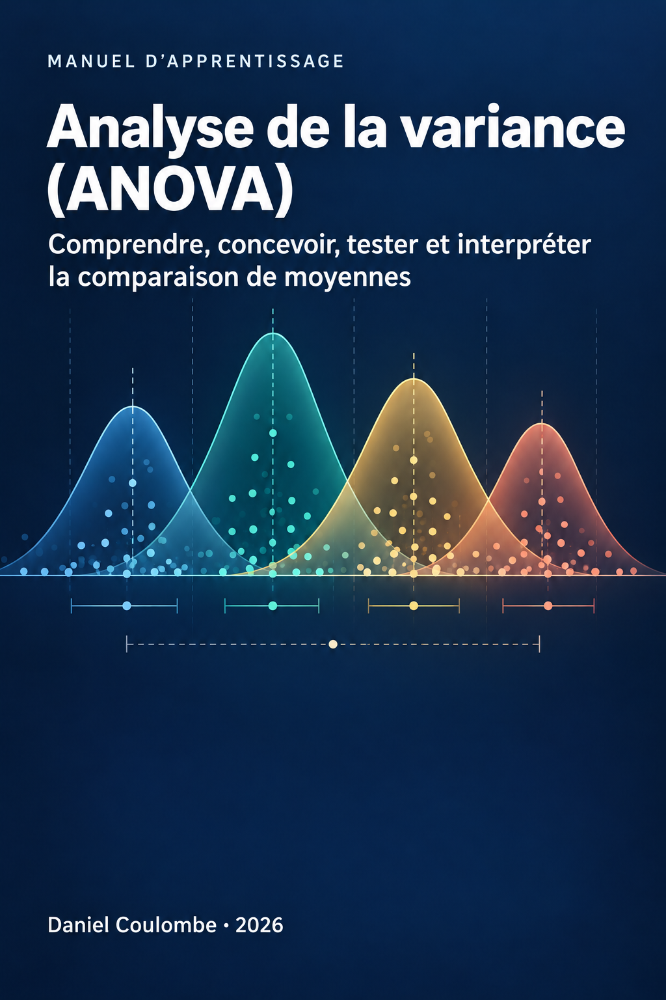

::: {.content-hidden when-format="epub"}
::: {.content-visible when-format="html"}
::: {.cover-image}
{alt="Couverture du manuel Analyse de la variance (ANOVA), Daniel Coulombe, 2026"}
:::
:::
:::

# Préface {.unnumbered}

Comparer des moyennes paraît simple : on calcule une moyenne par groupe et on regarde si elles se ressemblent. Pourtant, cette intuition laisse deux questions essentielles sans réponse. Les différences observées sont-elles plus grandes que ce que produirait le hasard d'échantillonnage? Et, si une différence existe, est-elle suffisamment importante pour compter dans le problème étudié?

L'ANOVA à un facteur répond à la première question en comparant deux sources de variabilité : les écarts **entre** les groupes et les écarts **à l'intérieur** de chaque groupe. Ce manuel accompagne l'application interactive *Analyse de la variance (ANOVA)*. L'application permet de modifier les tailles de groupes, les moyennes et les écarts-types, puis d'en voir immédiatement les conséquences sur les données, les postulats, le test $F$, les comparaisons et la puissance. Le manuel explique le raisonnement qui rend ces sorties interprétables.

L'objectif n'est pas de faire mémoriser une liste de tests. Il est de savoir poser une question de comparaison de moyennes, choisir un plan, évaluer ses limites et communiquer une conclusion proportionnée aux données.

## Objectifs d'apprentissage {.unnumbered}

À la fin du parcours, vous pourrez :

- reconnaître une situation qui relève d'une ANOVA à un facteur, et la distinguer d'une situation qui demande un autre modèle;
- distinguer la variabilité intergroupes de la variabilité intragroupe, dans la population comme dans l'échantillon;
- lire et expliquer un tableau ANOVA, et en refaire les calculs, sans réduire l'analyse à la valeur $p$;
- évaluer les principaux postulats et choisir une réponse raisonnable à leur violation;
- choisir entre comparaisons a posteriori, contrastes planifiés et analyse de tendance;
- rapporter une taille d'effet et réfléchir à la puissance avant la collecte;
- réaliser un parcours complet et défendable avec l'application, et en rédiger le compte rendu.

## Organisation du manuel {.unnumbered}

| Partie | Chapitres | Onglets de l'application |
|:------------------|:----------------------------------------------|:------------------------------------|
| **Comprendre** | 1. Quand comparer des moyennes? · 2. Concevoir la comparaison avant de générer les données · 3. La logique des sommes de carrés | **Introduction**, **Données ▸ Conception**, **Analyse ▸ Décomposition** |
| **Analyser** | 4. Des données simulées à leur description · 5. Évaluer les postulats avec jugement · 6. Le tableau ANOVA et le test $F$ | **Données ▸ Données simulées**, **Données ▸ Postulats**, **Analyse ▸ Tableau ANOVA** |
| **Approfondir** | 7. Après le test global : quelles moyennes diffèrent? · 8. Contrastes planifiés et tendances · 9. Importance pratique et puissance | **Analyse ▸ Comparaisons**, **Analyse ▸ Taille d'effet & Puissance** |
| **Pratiquer** | 10. Laboratoire guidé dans l'application · 11. Décider et rapporter une ANOVA · 12. Exercices et corrigés | tous les onglets |

: Les parties du manuel et les onglets correspondants. {#tbl-plan}

Chacun des neuf premiers chapitres s'ouvre sur ses objectifs et son idée centrale, alterne explications, figures et encadrés **Dans l'application**, puis se termine par un **laboratoire** (avec sa réponse repliée), un résumé et un court quiz. Le glossaire, à la fin, comprend une table de correspondance entre les notions du manuel et les écrans de l'application. Les figures qui ne sont pas des captures d'écran ont été calculées pour le manuel avec les mêmes formules que l'application.

## Le cas fil rouge {.unnumbered}

::: {.case}
Tout au long du manuel, nous suivons une étude fictive : une faculté assigne au hasard des étudiantes et étudiants à l'un de trois dispositifs de soutien, puis mesure un score de réussite sur 100. **Au démarrage, l'application affiche précisément ce cas** : 3 groupes de 30 personnes, moyennes de population 50, 54 et 60, écart-type commun 10, **graine 2026**. Les captures d'écran et les nombres cités dans le texte proviennent de cet échantillon, sauf mention contraire.
:::

Pour retrouver le cas fil rouge après avoir modifié les réglages, il suffit de recharger la page de l'application, ou de remettre ces valeurs dans le panneau latéral et d'inscrire 2026 dans la case **Graine**.

## Comment travailler avec le manuel {.unnumbered}

Lisez chaque chapitre avec l'application ouverte. Les encadrés **Dans l'application** indiquent le parcours précis. Ne cherchez pas d'abord à obtenir une valeur $p$ « intéressante » : modifiez un seul paramètre à la fois, gardez la même graine, et décrivez ce qui change. Cette habitude transforme le simulateur en laboratoire de raisonnement.
